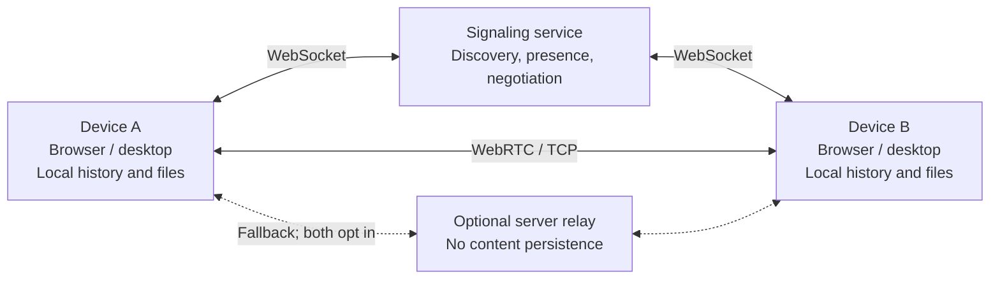

# Hummingbird

English | [简体中文](README.zh.md) · [GitHub](https://github.com/kuangye-team/ky-im)

Connect easily. Share freely.

Hummingbird is a local-network chat and file-sharing app for browsers, PWAs, and macOS / Windows desktop clients (Ky IM). No account is required. Text, images, files, and folders travel directly between devices whenever possible, and each device keeps its own history.

By default, the server handles device discovery and connection negotiation without storing chat content. Desktop clients also discover devices locally, enabling LAN communication without a central server.

[Features](#features) · [Architecture](#architecture) · [Quick start](#quick-start) · [Configuration](#configuration) · [Installation and deployment](#installation-and-deployment) · [Contributing](#contributing) · [Copyright and license](#copyright-and-license)

## Features

| Capability | Browser / PWA | Desktop app |
| --- | --- | --- |
| Device discovery | Signaling service discovers devices in the same group and supports cross-group lookup | Signaling and local mDNS discovery, with duplicate devices merged |
| Content transfer | Peer-to-peer text, images, files, and folders over WebRTC | TCP first, then WebRTC on failure; interoperates with browsers |
| Optional relay | Server fallback after direct connection failure, requiring server support and both devices to opt in | Same as browser; disabled by default |
| Local storage | IndexedDB, subject to browser storage quotas | SQLite for history and the local filesystem for attachments |
| Large files and folders | Chunked transfers; direct saves depend on browser filesystem support | Native file access and streaming to disk, preserving directory structure |
| Access | Desktop and mobile browsers, PWA installation, offline access to local history | macOS / Windows, including LAN communication without Internet access |
| Languages | English and Chinese | English and Chinese |

## Architecture



Discovery, transport, and storage are separate adapters around a shared `ChatEngine`, which handles messages, file transfers, and persistence. Devices use a persistent local UUID to merge results from multiple discovery sources. Files are transferred in chunks with support for streaming reads and writes.

The Rust backend shares its core logic across two runtimes: the native service uses Axum / Tokio with in-memory presence, while the Cloudflare version uses Workers / Durable Objects to store presence data. Optional relay forwards only the active transfer; neither backend stores chat history or relay content.

| Module | Technology and responsibility | Source |
| --- | --- | --- |
| Web and shared logic | React, TypeScript, Vite; UI, chat engine, network and storage adapters | [`ssg/src/`](ssg/src) |
| Desktop app | Tauri 2, Rust; mDNS / TCP, SQLite, local filesystem | [`app/src/`](app/src) |
| Signaling and relay | Rust; native and Cloudflare runtimes | [`api/src/`](api/src) |
| Shared protocol | Network types shared by the server and desktop app | [`shared/`](shared) |
| Build and release | Configuration generation, license notices, desktop and server packaging | [`scripts/`](scripts) |

### Scope and limitations

- **Discovery and connectivity:** browser groups use `VITE_ROOM` and the source IP observed by the server, without scanning the LAN. Desktop discovery requires reachable IPv4 addresses, UDP 5353 multicast, and dynamic TCP ports. WebRTC has no STUN/TURN servers configured by default, so cross-network direct connections depend on reachability.
- **Availability and storage:** both devices must be online to transfer content. The server does not hold offline messages, and history does not automatically sync between devices. PWA offline caching provides app assets and access to local history; clearing site data removes the browser's local identity and history.
- **Identity and privacy:** group numbers, UUIDs, and server access keys do not authenticate contacts. Device identifiers can currently be impersonated; use the app between trusted devices. WebRTC encrypts transport, but desktop TCP is currently unencrypted. Relay is not end-to-end encrypted, so the relay server can access content. Public device profiles are sent to enabled discovery services.
- **Browser support:** receiving large files and original folders depends on filesystem APIs, storage quotas, and available space. Use HTTPS for production websites to support PWA and protected browser capabilities.

## Quick start

To run the app or host a service, choose a package or image under [Installation and deployment](#installation-and-deployment). Source development requires the following tools.

| Tool | Requirement | Purpose |
| --- | --- | --- |
| Node.js / npm | Node.js ≥ 22.12 | Configuration, frontend development, and builds |
| Rust / Cargo | Rust ≥ 1.91 | Native server and desktop app |
| Desktop platform dependencies | [Tauri 2 prerequisites](https://v2.tauri.app/start/prerequisites/) | Desktop development and packaging only |
| Docker / Compose | A working container runtime | Container deployment only; no host Rust installation needed |

Start with a fresh clone below. Keep any existing `.env.json` instead of replacing it.

```sh
git clone https://github.com/kuangye-team/ky-im.git
cd ky-im
npm ci
npm --prefix api ci
npm --prefix ssg ci
cp .env.json.example .env.json
npm run init
npm run prepare
npm run dev
```

Open <http://localhost:5173>. The frontend development server proxies `/api` to local port `8080`; `npm run dev` starts both the frontend and API.

| Scenario | Command from the repository root | Result |
| --- | --- | --- |
| Web development | `npm run dev` | Runs the website and native API together |
| Desktop development | `npm run desktop:dev` | Starts Ky IM; local discovery needs no API, while online discovery needs a separately started or hosted signaling service |
| Build and local preview | `npm run build`, then `npm run preview` | Builds the API and website; previews at `http://localhost:4173` |

## Configuration

For source development and builds, edit root `.env.json`, created from the [example](.env.json.example), then run `npm run init`. Generated environment files and `wrangler.jsonc` are overwritten; keep persistent changes in `.env.json` or the corresponding `.example` templates.

| Configuration section | Purpose | Generated files |
| --- | --- | --- |
| `local.api` / `local.ssg` | Local development | `api/.env.local`, `ssg/.env.local` |
| `production.api` / `production.ssg` | Native deployment and production web builds | `api/.env.production`, `ssg/.env.production` |
| `compose.root` / `compose.api` / `compose.ssg` | Docker ports, runtime settings, and frontend build arguments | Root `.env`, `api/.env.compose`, `ssg/.env.compose` |
| `desktop.app` / `desktop.ssg` | Desktop signing, release, and frontend settings | `app/.env`, `ssg/.env.desktop` |
| `wrangler.api` / `wrangler.ssg` | Cloudflare runtime variables | `api/wrangler.jsonc`, `ssg/wrangler.jsonc` |

Prebuilt images use a separately maintained `docker/.env`; server packages use `release/.env`. Neither is generated by initialization. Cloudflare frontend build settings still belong in `production.ssg`; `wrangler.*` only supplies runtime variables.

### Main settings

| Setting | Purpose and guidance |
| --- | --- |
| `VITE_SIGNAL_URL` | Signaling WebSocket URL; empty uses same-origin `/api/ws` on the web. Separate hosting requires a full `wss://…/api/ws` URL. Packaged desktop apps default to `ws://127.0.0.1:8080/api/ws` when empty |
| `VITE_ROOM` | Discovery namespace, default `local`; not access control |
| `API_AUTH` / `VITE_API_AUTH` | Server access key / frontend preset for the default server; use the same complete value. Empty `API_AUTH` disables authentication |
| `RELAY_ENABLED` | Server relay switch, default `false`; both devices must also opt in on the same server |
| `BIND_ADDR` / `STATIC_DIR` | Native listening address and static asset directory; relative paths resolve from the server's working directory |
| `CORS_ORIGINS` | Comma-separated frontend origins; add the website origin for separate hosting and retain required Tauri origins |
| `TRUST_PROXY_HEADERS` | Trust forwarded client IP headers; set to `false` for direct exposure and enable only behind a controlled reverse proxy |
| `MAX_CONNECTIONS` / `MAX_ROOMS` / `MAX_PEERS_PER_ROOM` | Limits for connections, discovery groups, and devices per group |
| `WEB_PORT` / `API_HOST` | Local web port and development proxy target; examples use `5173` and `http://127.0.0.1:8080` |
| `SERVER_PORT` / `NPM_REGISTRY` | Docker host port and build-time npm registry |
| `TAURI_UPDATER_URL` / `TAURI_UPDATER_PUBLIC_KEY` / `TAURI_SIGNING_PRIVATE_KEY` | HTTPS update manifest URL, public key, and signing private key required for desktop release builds |

`VITE_*` values are embedded in frontend assets and require rebuilding after changes. Accordingly, `VITE_API_AUTH` is not a server-only secret. The example access key is for demonstration; replace or clear it for deployment. With `API_AUTH` enabled, WebSocket access and health details require authentication; basic `/api/health` and static pages remain public.

For the full settings and defaults, see the [API template](api/.env.example), [frontend template](ssg/.env.example), [desktop template](app/.env.example), and [combined example](.env.json.example). Keep private keys and other sensitive configuration out of version control. Desktop builds also accept configuration through process environment variables.

## Installation and deployment

| Option | Suitable for | Artifact / entry point |
| --- | --- | --- |
| macOS desktop installer | Standalone app for Apple Silicon and Intel Macs | [GitHub Releases](https://github.com/kuangye-team/ky-im/releases): `ky-im-<version>-macos-universal.dmg` |
| Windows desktop installer | Standalone Windows x64 app | [GitHub Releases](https://github.com/kuangye-team/ky-im/releases): `ky-im-<version>-windows-x64-setup.exe` |
| Server package | Running the website and API without development tools | `ky-im-<version>-bin.tar.gz`: Windows x64, Linux / macOS x64 and ARM64 |
| Docker | Containerized website and API | [Prebuilt image configuration](docker/compose.yml) or [source build configuration](compose.yml) |
| Native source build | Self-hosted Rust service and static website | `api/target/release/server`, `ssg/dist/` |
| Cloudflare Workers | Hosted frontend and signaling | Workers Static Assets + Workers / Durable Objects |

### Docker

Prebuilt images require no Node.js or Rust. From the repository root, retaining any existing `docker/.env`:

```sh
cd docker
cp .env.example .env
docker compose pull
docker compose up -d
```

Open <http://localhost:8080>. Configure the image version and port in `docker/.env` ([example](docker/.env.example)). The prebuilt frontend uses same-origin signaling; changing frontend build settings requires a custom image.

For a source build, install dependencies, initialize configuration, and generate license notices first, then run from the repository root:

```sh
npm run init
docker compose up -d --build
```

The root Compose file already maps the host port, defaulting to `8080`. For local OrbStack use, add `--context orbstack` to Docker commands.

### Native service

After source setup and configuring `production`, run in a macOS / Linux shell:

```sh
npm run build
cd api
set -a
. ./.env.production
set +a
./target/release/server
```

The default configuration serves the website from `../ssg/dist`. For production, provide HTTPS/WSS through a reverse proxy and forward `/api`, including WebSocket `/api/ws` and the authentication endpoint `/api/ws/ticket`. Use `/api/health` for health checks. Separate frontend hosting requires both `VITE_SIGNAL_URL` and `CORS_ORIGINS`.

When enabling `TRUST_PROXY_HEADERS`, restrict origin access and have the proxy strip or overwrite all trusted forwarding headers, including `Forwarded`, so grouping uses the real client IP.

### Cloudflare Workers

After source setup, install the build tool matching the repository dependency and log in:

```sh
rustup target add wasm32-unknown-unknown
cargo install worker-build --version 0.8.7 --locked
(cd api && npx wrangler login)
```

Set Worker names and domains in the [API template](api/wrangler.jsonc.example) and [frontend template](ssg/wrangler.jsonc.example). Configure `wrangler.api.CORS_ORIGINS` and `production.ssg.VITE_SIGNAL_URL` in `.env.json`, then run:

```sh
npm run deploy
```

Use `npm run deploy:api` or `npm run deploy:ssg` to deploy separately. Server keys can be managed with Wrangler Secrets; remove the matching variable from `wrangler.api` when using an `API_AUTH` Secret.

### Desktop packaging

Install platform dependencies and configure the update URL and signing keys in `desktop.app` or process environment variables before running `npm run desktop:build`. A macOS universal build requires both Rust targets:

```sh
rustup target add aarch64-apple-darwin x86_64-apple-darwin
npm run desktop:build
```

On Windows, run `npm run desktop:build` directly to generate an x64 installer. Outputs in `app/dist/` include installers, signed update artifacts, checksums, and an update manifest. Update signing and operating-system code signing are configured separately; see the [desktop template](app/.env.example) and [release workflow](.github/workflows/release.yml).

For GitHub Actions desktop releases, configure repository-level entries under **Settings → Secrets and variables → Actions**. The desktop build reads the following names from Secrets first, then Variables:

| Name | Suggested location | Default when unset |
| --- | --- | --- |
| `VITE_SIGNAL_URL` | Variables | Empty; the packaged app connects to `ws://127.0.0.1:8080/api/ws` |
| `VITE_API_AUTH` | Secrets | Empty; no preset access key |
| `VITE_ROOM` | Variables | `local` |
| `VITE_STORAGE_CHUNK_SIZE` | Variables | `2097152` (2 MiB) |

These values are embedded during the desktop frontend build; rebuild the installers after changing them. The workflow does not read your local `.env.json` or generated `.env` files. `VITE_API_AUTH` remains readable in the distributed app even when configured as an Actions Secret.

## Contributing

Contributions are welcome through [Issues](https://github.com/kuangye-team/ky-im/issues) and [Pull Requests](https://github.com/kuangye-team/ky-im/pulls). Verify affected features and update relevant configuration and documentation. [CI](.github/workflows/ci.yml) covers frontend type checking, unit tests, real-browser communication tests, and desktop Rust checks. The [image](.github/workflows/docker-publish.yml) and [application release](.github/workflows/release.yml) workflows build and distribute artifacts.

## Copyright and license

Copyright (c) 2026 旷野团队. This project is licensed under the [MIT License](LICENSE). Third-party dependencies and assets retain their own licenses.

After installing or updating frontend dependencies, run `npm run prepare` to generate third-party notices in `ssg/public/licenses/` and distribute them with the frontend. Desktop release builds and GitHub Actions include this step; generate the notices before building the website or Docker image yourself.
