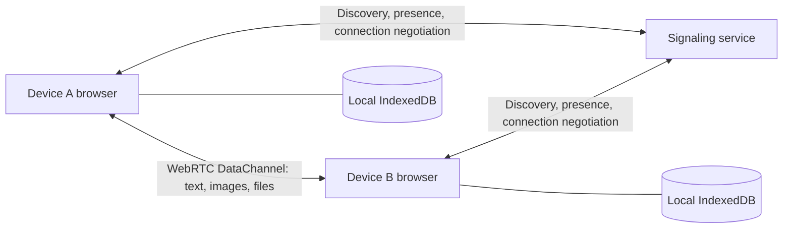

# Hummingbird

English | [简体中文](README.zh.md)

[GitHub](https://github.com/kuangye-team/ky-im)

Connect easily. Share freely.

Hummingbird is a local-network chat and file-sharing app. No account is required: open the website to discover devices on the same network and share text, images, and files. Chat content travels between devices over WebRTC, and each browser stores its own history.

**The signaling service handles device discovery, presence, and connection negotiation. It does not transmit or store chat content.**

[Features](#features) · [Quick start](#quick-start) · [Configuration](#configuration) · [Deployment](#deployment) · [How it works](#how-it-works) · [Development and testing](#development-and-testing) · [Contributing](#contributing) · [License](#license)

## Features

- **Ready to use**: automatically creates a local identity, with a display name, avatar, bio, and online status.
- **Device discovery**: finds online devices in the same group. A six-digit Hummingbird number lets you look up other groups.
- **Chat and sharing**: supports private chats, images, files, forwarding, and attachment downloads. Files up to 256 MiB are received automatically and stored in the browser. Larger files require the recipient to confirm and choose a save location; they are streamed to disk, and both browsers keep only the transfer record. Receiving large files requires a browser with a save-file picker, such as desktop Chrome or Edge over a secure connection. Interrupted transfers must be sent again.
- **Folder sharing**: choose or drag in a folder. Folders up to 256 MiB with up to 256 files are packed locally into ZIP files. Above either limit, the recipient chooses a location and receives the folder directly, with no attachment contents saved in either browser. Direct folder reception requires directory access support. Existing folders are preserved by choosing a new name; completed files remain after an interruption. Dragging folders or using the directory picker preserves empty directories; the compatibility file picker includes only directories containing files.
- **Local history**: stores contacts, contact nicknames, messages, and attachments in the browser, with export, deletion, and large-file cleanup.
- **Desktop and mobile**: responsive layouts, English and Chinese interfaces, and four themes.
- **Installable app**: supports PWA installation, offline access to saved history, and updates applied with the user's consent.

### Limitations

- Automatic discovery uses the same `VITE_ROOM` and the source IP observed by the server; it does not scan the local network. A Hummingbird number identifies an online group, not an account or password. The number is released when the last device in the group goes offline.
- No STUN/TURN servers are configured by default; only local ICE candidates are used. Finding a device by number does not guarantee that a direct connection across networks will succeed.
- Both devices must be online to send or receive content. The server does not hold offline messages, and history does not automatically sync between browsers or devices.
- Exports contain chat text and attachment metadata, **not the original images or files**. Download important attachments separately. Clearing the site's browser data removes the local identity and history.

## Quick start

The commands below are for macOS or Linux. Run them from the repository root unless stated otherwise.

To run without development tools, download a [release archive](#download-and-run) or use the [published Docker image](#docker-published-image).

### Requirements

| Tool | Requirement | Purpose |
| --- | --- | --- |
| Node.js / npm | Node.js ≥ 22.12.0 | Configuration generation, frontend development, and builds |
| Rust / Cargo | Rust ≥ 1.91 | Native signaling service |
| Browser | WebRTC and IndexedDB support | Using the app |
| Docker / Docker Compose | An existing, configured Docker environment; needed only for container deployment | Building and running containers |

### 1. Install dependencies and initialize configuration

Clone the repository and initialize the project:

```sh
git clone https://github.com/kuangye-team/ky-im.git
cd ky-im
npm ci
npm --prefix api ci
npm --prefix ssg ci
cp .env.json.example .env.json
npm run init
npm run prepare
```

Keep your existing `.env.json` if you already have one. The default frontend port is `5173`, and the signaling service uses `8080`. `npm run prepare` generates frontend license notices manually; dependency installation, development, and builds do not generate them automatically.

### 2. Start development

Start the signaling service and frontend together:

```sh
npm run dev
```

This generates configuration once and starts both services. The Rust service loads `api/.env.local`; existing process environment variables take precedence. Press Ctrl+C to stop both services. You can also run `npm run dev:api` and `npm run dev:ssg` in separate terminals.

Open <http://localhost:5173>. The development server proxies `/api` requests and WebSocket connections to the local signaling service.

Use two separate browsers or browser profiles to try chatting without sharing a local identity. Other devices can connect through the development machine's LAN address if its firewall allows access. App installation and offline caching require HTTPS; `localhost` is suitable for local development.

### 3. Preview a production build

```sh
npm run build
npm run preview
```

`build` builds both the native API and frontend. `preview` starts the release API with `api/.env.production` and serves `ssg/dist` through Vite at <http://localhost:4173>. The preview server proxies `/api` requests and WebSocket connections using `local.ssg.API_HOST`; keep it aligned with `production.api.BIND_ADDR`. Rebuild after frontend changes. Preview is intended for local verification; see [Deployment](#deployment) for production hosting.

Use `npm run preview:api` or `npm run preview:ssg` to start either service separately. Both combined startup commands stop the other service if one exits.

## Configuration

Edit the root `.env.json`, using [`.env.json.example`](.env.json.example) as a reference, then run:

```sh
npm run init
```

The initialization script uses the example files as templates to generate the files below. **Manual edits to generated files are overwritten the next time initialization runs.**

| Configuration section | Generated files | Purpose |
| --- | --- | --- |
| `local.api` / `local.ssg` | `api/.env.local` / `ssg/.env.local` | Local development |
| `production.api` / `production.ssg` | `api/.env.production` / `ssg/.env.production` | Native deployment / production frontend build |
| `compose.root` + `compose.ssg` | Root `.env` | Docker port, npm registry, and frontend build arguments |
| `compose.api` / `compose.ssg` | `api/.env.compose` / `ssg/.env.compose` | Docker service configuration / frontend configuration copy |
| `wrangler.api` / `wrangler.ssg` | `api/wrangler.jsonc` / `ssg/wrangler.jsonc` | Cloudflare runtime `vars` |

### Common settings

| Setting | Description |
| --- | --- |
| `WEB_PORT` | Local frontend port, set only in `local.ssg`; example: `5173` |
| `API_HOST` | Development proxy target, set only in `local.ssg`; example: `http://127.0.0.1:8080` |
| `VITE_SIGNAL_URL` | Signaling WebSocket URL; leave empty to use `/api/ws` on the page's origin, or set a complete `wss://…/api/ws` URL for separate deployments |
| `VITE_ROOM` | Device discovery namespace, defaulting to `local`; accepts 1–64 ASCII letters, digits, underscores, or hyphens; not an access-control mechanism |
| `BIND_ADDR` | Native service listening address; local example: `127.0.0.1:8080`; container example: `0.0.0.0:8080` |
| `STATIC_DIR` | Frontend directory served by the native backend; relative paths use the service's working directory; containers use `/app/static` |
| `CORS_ORIGINS` | Allowed frontend origins, comma-separated, without paths or trailing slashes; leave empty for same-origin browser connections only |
| `TRUST_PROXY_HEADERS` | Whether the native service trusts forwarded client IP headers; enabled by default; set to `false` when exposing the service directly without a proxy under your control |
| `MAX_CONNECTIONS` | Maximum connections per signaling instance; range: `2–4096`; example: `4096` |
| `MAX_ROOMS` | Maximum automatic discovery groups; range: `1–256`; example: `256` |
| `MAX_PEERS_PER_ROOM` | Maximum online devices per group; range: `2–512`; example: `128` |
| `SERVER_PORT` | Docker host port in `compose.root`; takes effect when port mapping is enabled |
| `NPM_REGISTRY` | npm registry used for Docker builds, set in `compose.root` |

`VITE_*` values are embedded in the frontend at build time, so changes require a rebuild. Production builds read `ssg/.env.production`, whose values override matching entries in `.env.local`; process environment variables take precedence. Docker injects `compose.ssg` values through `build.args`, and environment files are not copied into the image.

Connection timeouts, file limits, and transfer buffers are configured in [`ssg/src/config.ts`](ssg/src/config.ts). Theme settings are in [`ssg/src/theme-config.ts`](ssg/src/theme-config.ts).

## Deployment

### Download and run

Download and extract `ky-im-<version>.tar.gz` from GitHub Releases. It includes the frontend, native servers for Windows x64, Linux x64/ARM64, and macOS Intel/Apple Silicon, plus Docker configuration. Native startup requires no Node.js, Rust, or Docker.

Run `sh release/start_linux.sh`, `sh release/start_mac.sh`, or `release\start_win.bat`, then open <http://localhost:8080>. The launcher creates `release/.env` on first use and preserves it thereafter. See the [release guide](release/README.md) for configuration and updates; a `.sha256` file is provided for verification.

### Docker: published image

[`docker/compose.yml`](docker/compose.yml) starts the website and signaling service using `kyteam/ky-im` from Docker Hub by default. Only Docker and Docker Compose are needed; Node.js and Rust are not required.

After cloning the repository, run from its root:

```sh
cd docker
cp .env.example .env
docker compose pull
docker compose up -d
```

Open <http://localhost:8080>. Keep an existing `docker/.env` instead of overwriting it. Set `SERVER_PORT` there to change the host port, `IMAGE_NAME` to use a custom repository, or `IMAGE_TAG` to select `latest`, an exact release such as `v1.0.0`, or a minor release series such as `v1.0`. You can also copy just the `docker/` directory to your server. This configuration is independent of the root `.env.json` and `npm run init`.

To update, run `docker compose pull && docker compose up -d` in `docker/`. Use `docker compose logs -f im` for logs and `docker compose down` to stop. The example disables `TRUST_PROXY_HEADERS` for direct access; enable it when using a trusted reverse proxy. Other backend settings can be added to `docker/.env`. The published frontend uses `VITE_ROOM=local` and same-origin signaling; changing `VITE_*` requires building your own image.

### Docker: build from source

Use your existing Docker and Docker Compose environment. Complete dependency installation, configuration initialization, and license notice generation from the quick start first. Rust does not need to be installed on the host for Docker-only deployment.

Port mapping is commented out in [`compose.yml`](compose.yml). To access the app through a host port, enable this under `services.im`:

```yaml
ports:
  - "${SERVER_PORT:-8080}:8080"
```

Then run from the repository root:

```sh
npm run init
docker compose up -d --build
```

The container serves both the website and signaling endpoints. With the default port mapping, open <http://localhost:8080>. Use `docker compose logs -f im` for logs and `docker compose down` to stop. Repeat the commands above after changing frontend build settings.

### Publishing images and archives with GitHub Actions

The [Docker publishing workflow](.github/workflows/docker-publish.yml) builds and pushes the repository configured in `DOCKERHUB_IMAGE`, defaulting to `kyteam/ky-im` when unset. In the GitHub repository's **Settings → Secrets and variables → Actions**, configure these repository secrets:

| Secret | Value |
| --- | --- |
| `DOCKERHUB_USERNAME` | Docker Hub username with write access to the selected repository |
| `DOCKERHUB_TOKEN` | Docker Hub access token with write permission |
| `DOCKERHUB_IMAGE` | Optional repository name, such as `your-team/ky-im`; defaults to `kyteam/ky-im` |

| Trigger | Published image tags | Downloadable archive |
| --- | --- | --- |
| Push to `main`, including a merged pull request | `latest` | None |
| Push a three-part version tag such as `v0.2.20` | `v0.2.20`, `v0.2` | `ky-im-0.2.20.tar.gz` on GitHub Releases |

Version tags keep the `v` prefix and do not update `latest`. Two-part tags and prerelease tags such as `v1.0.0-rc.1` do not trigger publishing. To publish a release:

```sh
git tag v0.2.20
git push origin v0.2.20
```

The independent [release workflow](.github/workflows/release.yml) builds the frontend and five native servers, verifies each platform's launcher, and uploads the archive and checksum to GitHub Releases. Both workflows generate license notices before building. Archive publishing uses `GITHUB_TOKEN` and needs no Docker credentials.

The archive pins its Docker configuration to the release tag; wait for the Docker workflow to finish before using that image. See the [release guide](release/README.md) for local packaging.

### Native deployment

After installing dependencies as described in the quick start, update the `production` section in `.env.json` for your deployment, especially `CORS_ORIGINS` and `TRUST_PROXY_HEADERS`, then run:

```sh
npm run build

cd api
set -a
. ./.env.production
set +a
./target/release/server
```

The default configuration serves the frontend from `../ssg/dist`. For a public deployment, use a reverse proxy to provide HTTPS and forward WebSocket connections to `/api/ws`. If the frontend is hosted separately, configure `VITE_SIGNAL_URL` and `CORS_ORIGINS` accordingly.

### Cloudflare Workers

The API runs on Workers with a `SignalingHub` Durable Object; the frontend uses [Workers Static Assets](https://developers.cloudflare.com/workers/static-assets/). After the quick-start dependency installation, install the [Rust Workers build tools](https://developers.cloudflare.com/workers/languages/rust/) and sign in:

```sh
rustup target add wasm32-unknown-unknown
cargo install worker-build --version 0.8.7 --locked
(cd api && npx wrangler login)
```

Set Worker names and any custom domains in `api/wrangler.jsonc.example` and `ssg/wrangler.jsonc.example`. In `.env.json`, set:

- `wrangler.api.CORS_ORIGINS` to the frontend origin, such as `https://ky-im-ssg.<subdomain>.workers.dev`.
- `production.ssg.VITE_SIGNAL_URL` to the API's full WebSocket URL, such as `wss://ky-im-api.<subdomain>.workers.dev/api/ws`.

Then deploy both services from the repository root:

```sh
npm run deploy
```

Use `npm run deploy:api` or `npm run deploy:ssg` to deploy one service. Each command regenerates configuration; Wrangler builds the selected service before uploading it. The API uses `build:worker` to produce `api/build/`, while native `build` commands retain their existing behavior.

`wrangler.*` values populate runtime `vars`; they do not set Vite build variables. Keep frontend settings in `production.ssg`. Generated `wrangler.jsonc` files are ignored by Git and overwritten by `init`; keep persistent changes in the templates or `.env.json`. To build only the Worker, run `npm --prefix api run build:worker`.

## How it works



The frontend uses React, TypeScript, and Vite. It stores local data through `IndexedDBStorageAdapter` by default, with the storage interface defined by `StorageAdapter`. Each local identity has a UUID; changing an IP address, Hummingbird number, or display name does not merge histories belonging to different identities.

The Rust backend shares its core logic between two runtimes: the native service uses Axum / Tokio with in-memory presence, while the Cloudflare backend uses Workers / Durable Objects. WebSocket messages handle discovery and control operations. The `signal` payload accepts only structured SDP / ICE negotiation data; there are no chat-message or attachment-upload endpoints.

### Service endpoints

| Endpoint | Purpose |
| --- | --- |
| `GET /api/health` | Basic health check |
| `GET /api/health/details` | Online device and group status; accesses and wakes the Durable Object in the Cloudflare backend |
| `WS /api/ws` | Device joins, group lookup, presence updates, and WebRTC connection negotiation |

Incoming signaling messages are limited to 256 KiB. Connection capacity and message rates are also limited. See [`api/src/protocol.rs`](api/src/protocol.rs) for the protocol definitions.

## Development and testing

### Project structure

```text
.
├── api/                    # Rust signaling service: native and Cloudflare backends
│   ├── src/                # Shared logic and runtime implementations
│   └── tests/              # Native signaling integration tests
├── ssg/                    # React / Vite frontend
│   ├── src/core/           # WebRTC, protocol, and local storage
│   ├── src/components/     # UI components
│   ├── public/             # Icons and other static assets
│   └── tests/              # Playwright browser tests
├── scripts/                # Configuration, service startup, and manual license generation
├── docker/                 # Run a published Docker Hub image
├── release/                # Native launchers, environment example, and release guide
├── .github/workflows/      # Publish Docker images and downloadable release archives
├── .env.json.example       # Shared configuration example
├── compose.yml             # Build and run the image from source
└── Dockerfile              # Combined frontend and backend image
```

### Common commands

Run these commands from the repository root:

| Command | Purpose |
| --- | --- |
| `npm run init` | Generate environment files and Wrangler configuration from `.env.json` and templates |
| `npm run prepare` | Generate frontend license notices after installing or updating dependencies |
| `npm run dev` / `dev:api` / `dev:ssg` | Start both development services or one service |
| `npm run build` / `build:api` / `build:ssg` | Build the native service and frontend, or either one |
| `npm run preview` / `preview:api` / `preview:ssg` | Preview production builds locally |
| `npm run deploy` / `deploy:api` / `deploy:ssg` | Build and deploy both services or one service to Cloudflare |

The development, build, preview, and deploy commands above run `init` first. Before invoking subdirectory commands directly, run `npm run init`; build the frontend before previewing it.

Run checks relevant to your changes:

```sh
# Frontend type checks and unit tests
npm --prefix ssg test

# Rust unit and signaling integration tests
npm --prefix api test

# Browser tests: build the frontend, then test desktop, mobile, and PWA behavior
npm --prefix ssg run test:browser

# PWA installation, offline behavior, and updates only
npm --prefix ssg run test:browser -- --project=pwa
```

Browser tests use installed Chrome by default. To use Chromium, run `npx playwright install chromium` in `ssg/` and set `PLAYWRIGHT_CHANNEL=chromium`. Tests start local services on ports `4310` and `4311`; PWA tests use temporary ports. Reports go to `ssg/test-results/`.

### App installation and updates

With HTTPS in production, install the app through a supported browser's menu. On iPhone / iPad, use **Add to Home Screen**; in macOS Safari, use **Add to Dock**.

[`ssg/public/favicon.svg`](ssg/public/favicon.svg) is the source app icon. Builds generate theme icons, installation icons, and Apple icons. The service worker caches static app assets only; signaling endpoints are not cached. The development server does not register a service worker.

When a new version is ready, the app shows an update notice. The user chooses **Update and reload** to apply it. Updates pause during transfers, unsent text stays in the current tab, and updating one tab does not force other tabs to refresh.

## Contributing

[Issues](https://github.com/kuangye-team/ky-im/issues) and [pull requests](https://github.com/kuangye-team/ky-im/pulls) are welcome.

1. Describe the problem, steps to reproduce it, and your browser and network environment. Include screenshots for UI issues when useful.
2. Create a separate branch and keep each change focused on one problem or feature.
3. Run tests for the affected functionality first, and describe the changes and validation in your pull request.
4. Update documentation when configuration, commands, or usage changes. Keep test screenshots and reports in `ssg/test-results/`, and do not commit generated artifacts.

Preserve the architecture boundary: **text, images, and files must travel through WebRTC data channels, never through the signaling service for relay or storage.**

## License

This project is licensed under the [MIT License](LICENSE). Third-party components remain subject to their own licenses.

After installing or updating frontend dependencies, run `npm run prepare` to generate notices in `ssg/public/licenses/`, shown on the app's **Open-source licenses** page. Installation, development, and builds do not generate them automatically. Generate them before releasing; GitHub Actions does this explicitly for Docker images and archives.
