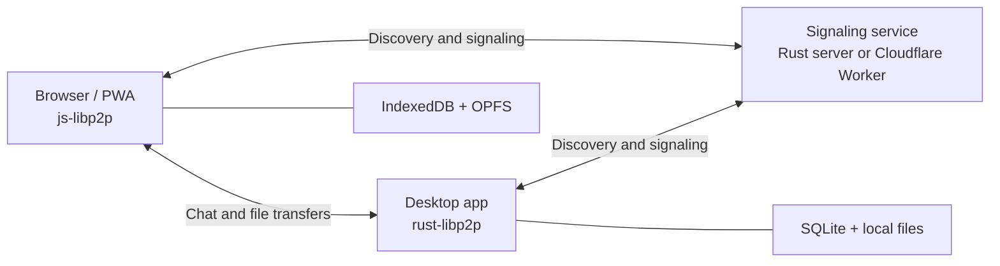

# Hummingbird

English | [简体中文](README.zh.md) · [GitHub](https://github.com/kuangye-team/ky-im)

Hummingbird is a local-network chat and file-sharing app for browsers, PWAs, and macOS and Windows desktops (Ky IM). Devices exchange text, images, files, and folders directly whenever possible. Each device keeps its own history. No account is required.

## Features

| Capability | Browser / PWA | Desktop app |
| --- | --- | --- |
| Find a device | Discover nearby devices through a signaling server or look up a six-digit Hummingbird number | Also discover devices on the LAN through mDNS, even without a server or internet access |
| Chat and share | Share with other browsers over WebRTC or connect directly to a desktop | Connect to browsers over WebTransport or WebRTC or to desktops over TCP, QUIC, or WebRTC |
| Reach a peer through a relay | Both peers can opt in to an end-to-end encrypted relay on the same server | Same as browser |
| Keep history offline | History and attachments stay in browser storage, subject to the site's quota | History stays on the device. Attachments can live on a separate drive |
| Transfer large files and folders | Stream to storage and resume interruptions while the page stays open | Stream to disk and resume interruptions while the app stays open |

## Architecture

The signaling service introduces devices and helps them establish a connection. Messages and files travel between authenticated peers. When the optional server relay is enabled, it forwards encrypted traffic. The server stores no chat history.



The clients share the React interface and the engine for contacts, messages, and file transfers. The browser handles network and file access in JavaScript. The desktop app uses Rust for files and peer connections. Compatible browsers connect back when the desktop announces its addresses. Both peers reuse that connection and can negotiate WebRTC through the signaling server when needed. Its system WebView shares the browser’s WebRTC implementation. Desktop peers can also exchange files over native TCP or QUIC. [Communication design](docs/arch.md) · [Capability negotiation](docs/capabilities.md)

## Installation and deployment

| Goal | Start here |
| --- | --- |
| Install the desktop app | Download the universal macOS installer or Windows x64 installer from [GitHub Releases](https://github.com/kuangye-team/ky-im/releases). |
| Host the website and API | Extract `ky-im-<version>-bin.tar.gz` from the same release. Run `start_linux.sh`, `start_mac.sh`, or `start_win.bat` in the extracted `release/` directory. |
| Run with Docker | Use the [prebuilt image](docker/compose.yml) as shown below. To build a custom image, complete source setup and run `npm run compose` from the repository root. |
| Build the native service | After source setup, run `npm run build`, then `npm run preview:api` to serve the website and API together. |
| Deploy on Cloudflare | Host the website with Workers Static Assets and signaling with Durable Objects. [Worker setup](docs/option.md#cloudflare-workers) |

To start the prebuilt image from the repository root, run the following commands and open <http://localhost:8080>.

```sh
cd docker
cp -n .env.example .env
docker compose pull
docker compose up -d
```

## Develop from source

Install Node.js 22.12 or later with npm, and Rust 1.91 or later with Cargo. For desktop development, also install the [Tauri platform prerequisites](https://v2.tauri.app/start/prerequisites/).

```sh
git clone https://github.com/kuangye-team/ky-im.git
cd ky-im
npm ci
npm --prefix api ci
npm --prefix ssg ci
cp -n .env.json.example .env.json
npm run prepare
npm run dev
```

Open <http://localhost:5173>. The development command initializes configuration and starts the web app and API together. Use `npm run desktop:dev` for the desktop app. To build installers, configure update signing and run `npm run desktop:build`. [Desktop packaging](docs/option.md#desktop-packaging)

## Configuration

For source builds, edit the root `.env.json` and run `npm run init`. If you host the website and API together, leave `VITE_SIGNAL_URL` empty to use the site's own server. For separate hosts, set it to the API's public WebSocket URL and add the website origin to `CORS_ORIGINS`. Replace or clear the example access key before deploying.

The configuration reference covers each deployment's settings file, defaults, and which changes require a rebuild. [Configuration reference](docs/option.md) · [Example configuration](.env.json.example)

## Contributing

Verify affected features and update the corresponding documentation in both languages. [Issues](https://github.com/kuangye-team/ky-im/issues) · [Pull requests](https://github.com/kuangye-team/ky-im/pulls) · [CI checks](.github/workflows/ci.yml)

## Copyright and license

Copyright (c) 2026 旷野团队. Hummingbird is distributed under the [MIT License](LICENSE). Third-party dependencies and assets retain their respective licenses. Run `npm run prepare` after installing or updating frontend dependencies to include their notices in the distribution.
