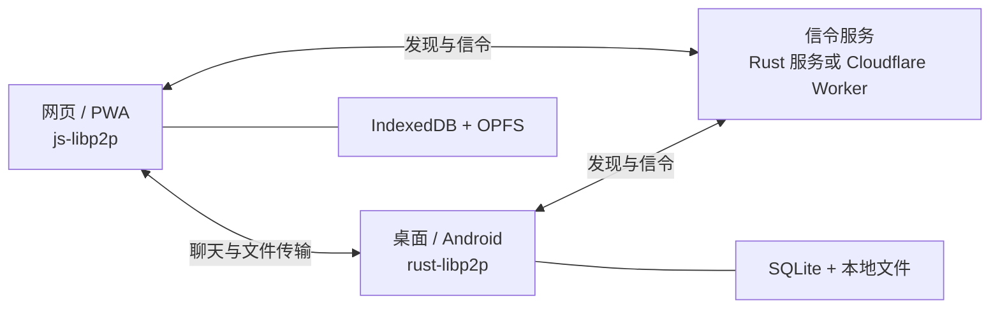

# 蜂鸟 · Hummingbird

[English](README.md) | 简体中文 · [GitHub](https://github.com/kuangye-team/ky-im)

蜂鸟是一款局域网聊天与文件分享应用，支持网页、PWA、Android，以及 macOS 和 Windows 桌面客户端（Ky IM）。无需注册账号，设备之间优先直传文字、图片、文件和文件夹，聊天记录保存在各自设备上。

## 能力特性

| 能力 | 网页 / PWA | 桌面客户端 |
| --- | --- | --- |
| 查找设备 | 通过信令服务发现附近设备，也可按六位蜂鸟号查找 | 还支持通过 mDNS 在局域网内发现设备，无需服务器或互联网连接 |
| 断网后恢复 | 网络恢复时自动重新查找设备 | 也会在本机网卡地址变化时重新查找 |
| 聊天与分享 | 网页之间通过 WebRTC 互传，也可直连桌面客户端 | 通过 WebTransport 或 WebRTC 与网页互通，桌面之间还支持 TCP 和 QUIC |
| 通过服务器中转 | 双方可在同一服务器上启用端到端加密中转 | 与网页相同 |
| 离线查看记录 | 记录和附件保存在浏览器中，容量受站点配额限制 | 记录保存在本机，附件可放在其他磁盘 |
| 传输大文件和文件夹 | 边接收边写入，保持页面打开即可在短暂断线后续传 | 边接收边写入磁盘，保持应用运行即可在短暂断线后续传 |

Android 客户端沿用同一套聊天引擎。一个 APK 同时包含 ARM64 和 ARMv7，收到的附件可保存到手机上选定的文件夹。[Android 构建与验收](docs/android.zh.md)

## 架构原理

信令服务负责发现设备并协助建立连接。连接建立后，通过身份验证的设备直接交换消息和文件。启用可选的服务端中转后，服务器只转发密文。聊天记录保存在通信双方的设备上。



网页与桌面共用 React 界面，以及管理联系人、消息和文件传输的业务引擎。网页由 JavaScript 处理网络通信和文件读写，桌面由 Rust 管理文件和设备连接。桌面客户端上线后，兼容的网页会主动尝试直连。双方可复用连接收发内容，直连失败时按需通过中心协商 WebRTC。系统 WebView 与网页共用 WebRTC 收发代码，桌面之间也可通过原生 TCP 或 QUIC 直传。[通信设计](docs/arch.zh.md) · [能力协商](docs/capabilities.zh.md)

## 安装部署

| 场景 | 入口 |
| --- | --- |
| 安装或更新 Android 客户端 | 首次安装可从发布页下载 `ky-im-<version>-android-arm.apk`。安装后可在「我的 → 关于蜂鸟」检查更新。 |
| 安装桌面客户端 | 在 [GitHub Releases](https://github.com/kuangye-team/ky-im/releases) 下载 macOS 通用安装包或 Windows x64 安装包。 |
| 自行托管网页与 API | 从同一发布页下载并解压 `ky-im-<version>-bin.tar.gz`，在解压后的 `release/` 目录运行对应平台的 `start_linux.sh`、`start_mac.sh` 或 `start_win.bat`。 |
| 用 Docker 部署 | 按下方命令启动[预构建镜像](docker/compose.yml)。如需定制镜像，完成源码环境准备后，在仓库根目录运行 `npm run compose`。 |
| 从源码构建原生服务 | 完成源码环境准备后，运行 `npm run build`，再用 `npm run preview:api` 同时提供网页与 API。 |
| 部署到 Cloudflare | 网页由 Workers Static Assets 托管，信令服务使用 Durable Objects。[Worker 部署配置](docs/option.zh.md#cloudflare-workers) |

使用预构建镜像时，从仓库根目录执行以下命令，然后访问 <http://localhost:8080>。

```sh
cd docker
cp -n .env.example .env
docker compose pull
docker compose up -d
```

## 从源码开发

准备 Node.js 22.12 或更高版本（含 npm），以及 Rust 1.91 或更高版本（含 Cargo）。开发桌面端还需安装 [Tauri 平台依赖](https://v2.tauri.app/start/prerequisites/)。

```sh
git clone https://github.com/kuangye-team/ky-im.git
cd ky-im
npm ci
npm --prefix api ci
npm --prefix ssg ci
cp -n .env.json.example .env.json
npm run prepare
npm run dev
```

访问 <http://localhost:5173>。开发命令会初始化配置，并同时启动网页和 API。开发桌面端使用 `npm run desktop:dev`。打包时，先配置更新签名，再运行 `npm run desktop:build`。[桌面打包配置](docs/option.zh.md#桌面打包)

## 配置说明

从源码构建时，编辑根目录的 `.env.json` 后运行 `npm run init`。网页和 API 部署在同一站点时，`VITE_SIGNAL_URL` 留空即可连接本站服务。分开部署时，将它设为 API 的公网 WebSocket 地址，并把网页来源加入 `CORS_ORIGINS`。部署前请替换或清空示例访问密钥。

各部署方式的配置文件、默认值及修改后是否需要重新构建，见[配置参考](docs/option.zh.md)和[配置示例](.env.json.example)。

## 参与贡献

提交前请验证受影响的功能，并同步更新对应文档的中英文版本。[问题反馈](https://github.com/kuangye-team/ky-im/issues) · [提交修改](https://github.com/kuangye-team/ky-im/pulls) · [持续集成](.github/workflows/ci.yml)

## 版权与许可证

Copyright (c) 2026 旷野团队。蜂鸟采用 [MIT 许可证](LICENSE)，第三方依赖和素材遵循各自的许可证。安装或更新前端依赖后，运行 `npm run prepare` 将第三方许可声明纳入分发包。
