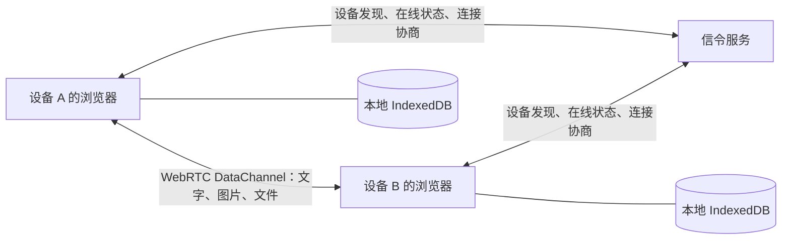

# 蜂鸟

[English](README.md) | 简体中文

[GitHub 开源仓库](https://github.com/kuangye-team/ky-im)

轻快连接，自在分享。

蜂鸟是一款面向局域网的聊天与文件分享应用。无需注册账号，打开网页即可发现同一网络中的设备，发送文字、图片和文件。聊天内容通过 WebRTC 在设备之间传输，记录保存在各自浏览器中。

**信令服务只负责设备发现、在线状态和连接协商，不传输或存储聊天内容。**

[功能特性](#功能特性) · [快速开始](#快速开始) · [配置说明](#配置说明) · [部署](#部署) · [工作原理](#工作原理) · [开发与测试](#开发与测试) · [贡献](#贡献) · [许可证](#许可证)

## 功能特性

- **即开即用**：自动生成本地身份，支持昵称、头像、个人介绍和在线状态设置。
- **发现设备**：自动发现同一分组中的在线设备，也可通过 6 位「蜂鸟号」查找其他分组。
- **聊天与分享**：支持私聊、图片、文件、消息转发和附件下载。256 MiB 以内自动接收并保存在浏览器；超过 256 MiB 需接收方确认并选择保存位置，分批直接写入磁盘，双方浏览器仅保留传输记录。超大文件接收需浏览器支持选择保存位置（如安全连接下的电脑版 Chrome / Edge）；中断后需重新发送。
- **文件夹分享**：支持选择或拖入文件夹。总大小不超过 256 MiB 且文件数不超过 256 时，在本机打包为 ZIP；超过任一限制则由接收方选择位置，直接保存为文件夹，双方浏览器不保存附件内容。直接接收需浏览器支持目录读写；遇到同名文件夹会另取名称，中断后已完成的文件会保留。拖入或使用目录选择器可保留空目录，兼容文件选择入口只包含有文件的目录。
- **本地记录**：联系人、备注、消息和附件保存在浏览器中，支持记录导出、删除和大文件清理。
- **多端体验**：适配桌面和手机，提供中英文界面与四种主题。
- **安装为应用**：支持 PWA 安装、离线查看已保存的记录，以及由用户确认的版本更新。

### 使用边界

- 自动发现依据是相同的 `VITE_ROOM` 和服务端可见的来源 IP，不是扫描局域网。蜂鸟号属于在线分组，不是个人账号或密码；分组最后一台设备离线后，该号码会被释放。
- 默认未配置 STUN/TURN，只使用本机 ICE 候选。通过蜂鸟号找到设备后，能否传输仍取决于设备之间的网络连通性，不能保证跨网连接成功。
- 发送和接收需要双方在线，服务端不提供离线消息代收。聊天记录不会自动同步到其他浏览器或设备。
- 导出文件包含聊天文字和附件信息，**不包含图片、文件原件**；重要附件请单独下载。清除浏览器站点数据会删除本地身份和记录。

## 快速开始

以下命令在 macOS / Linux 的终端执行，除特别说明外均从仓库根目录开始。

只需运行网站时，可[下载发布包直接运行](#下载发布包直接运行)，或使用 [Docker 预构建镜像](#docker预构建镜像)，无需安装开发工具。

### 环境要求

| 工具 | 要求 | 用途 |
| --- | --- | --- |
| Node.js / npm | Node.js ≥ 22.12.0 | 配置生成、前端开发与构建 |
| Rust / Cargo | Rust ≥ 1.91 | 原生信令服务 |
| 浏览器 | 支持 WebRTC 和 IndexedDB | 使用应用 |
| Docker / Docker Compose | 已配置好的 Docker 环境，仅容器部署需要 | 构建与运行容器 |

### 1. 安装依赖并初始化配置

克隆仓库并初始化项目：

```sh
git clone https://github.com/kuangye-team/ky-im.git
cd ky-im
npm ci
npm --prefix api ci
npm --prefix ssg ci
cp .env.json.example .env.json
npm run init
npm run prepare
```

已有 `.env.json` 时保留原文件。默认配置使用前端端口 `5173`、信令服务端口 `8080`。`npm run prepare` 手动生成前端许可声明；安装依赖、启动开发服务和构建时均不会自动生成。

### 2. 启动开发服务

同时启动信令服务和前端：

```sh
npm run dev
```

该命令生成一次环境配置后，同时启动两个服务。Rust 服务加载 `api/.env.local`，已设置的进程环境变量优先。按 Ctrl+C 可同时停止两个服务，也可在两个终端分别运行 `npm run dev:api` 和 `npm run dev:ssg`。

打开 <http://localhost:5173>。开发服务器会将 `/api` 请求和 WebSocket 连接代理到本地信令服务。

可使用两个不同的浏览器或浏览器配置文件体验聊天，避免共用同一份本地身份。其他设备访问时使用开发机的局域网地址，并确保防火墙允许访问；应用安装和离线缓存需要 HTTPS，本机 `localhost` 可用于开发。

### 3. 预览正式构建

```sh
npm run build
npm run preview
```

`build` 构建原生 API 和前端；`preview` 加载 `api/.env.production` 启动 release API，并通过 Vite 在 <http://localhost:4173> 提供 `ssg/dist`。预览服务使用 `local.ssg.API_HOST` 代理 `/api` 请求和 WebSocket 连接，请确保该地址与 `production.api.BIND_ADDR` 对应。前端修改后需重新构建。预览用于本地验证，正式托管方式见[部署](#部署)。

也可通过 `npm run preview:api` 或 `npm run preview:ssg` 单独启动对应服务。合并启动的 `dev` 和 `preview` 在任一服务退出时会停止另一个服务。

## 配置说明

统一在根目录 `.env.json` 中修改参数，字段结构参考 [`.env.json.example`](.env.json.example)，然后运行：

```sh
npm run init
```

初始化脚本以示例文件为模板生成以下文件，**手动修改生成文件会在下次初始化时被覆盖**。

| 配置位置 | 生成文件 | 用途 |
| --- | --- | --- |
| `local.api` / `local.ssg` | `api/.env.local` / `ssg/.env.local` | 本地开发 |
| `production.api` / `production.ssg` | `api/.env.production` / `ssg/.env.production` | 原生部署 / 前端正式构建 |
| `compose.root` + `compose.ssg` | 根目录 `.env` | Docker 端口、npm 源和前端构建参数 |
| `compose.api` / `compose.ssg` | `api/.env.compose` / `ssg/.env.compose` | Docker 服务配置 / 前端配置副本 |
| `wrangler.api` / `wrangler.ssg` | `api/wrangler.jsonc` / `ssg/wrangler.jsonc` | Cloudflare 运行时 `vars` |

### 常用参数

| 参数 | 说明 |
| --- | --- |
| `WEB_PORT` | 本地前端端口，仅放在 `local.ssg`，示例值为 `5173` |
| `API_HOST` | 开发代理目标，仅放在 `local.ssg`，示例值为 `http://127.0.0.1:8080` |
| `VITE_SIGNAL_URL` | 信令 WebSocket 地址；留空使用网页同源的 `/api/ws`，分开部署时填写完整的 `wss://…/api/ws` 地址 |
| `VITE_ROOM` | 设备发现的命名空间，默认 `local`；支持 1–64 位字母、数字、下划线或连字符，不用于访问控制 |
| `BIND_ADDR` | 原生服务监听地址；本地示例为 `127.0.0.1:8080`，容器示例为 `0.0.0.0:8080` |
| `STATIC_DIR` | 原生服务托管的前端目录；相对路径以服务启动目录为准，容器使用 `/app/static` |
| `CORS_ORIGINS` | 允许访问的前端来源，多个用逗号分隔，不带路径或末尾斜杠；留空仅允许同源浏览器连接 |
| `TRUST_PROXY_HEADERS` | 原生服务是否信任代理转发的客户端 IP；默认开启，直接对外提供服务且没有受控代理时设为 `false` |
| `MAX_CONNECTIONS` | 信令实例最大连接数，范围 `2–4096`，配置示例为 `4096` |
| `MAX_ROOMS` | 自动发现分组上限，范围 `1–256`，配置示例为 `256` |
| `MAX_PEERS_PER_ROOM` | 每个分组在线设备上限，范围 `2–512`，配置示例为 `128` |
| `SERVER_PORT` | Docker 宿主机端口，放在 `compose.root`；启用端口映射后生效 |
| `NPM_REGISTRY` | Docker 构建使用的 npm 源，放在 `compose.root` |

`VITE_*` 在构建时写入前端，修改后需要重新构建。正式构建读取 `ssg/.env.production`，其中的同名值覆盖 `.env.local`；进程环境变量优先。Docker 通过 `build.args` 注入 `compose.ssg` 的值，环境文件不会复制进镜像。

连接超时、文件大小、传输缓冲等选项集中在 [`ssg/src/config.ts`](ssg/src/config.ts)，主题配置位于 [`ssg/src/theme-config.ts`](ssg/src/theme-config.ts)。

## 部署

### 下载发布包直接运行

从 GitHub Releases 下载并解压 `ky-im-<版本>.tar.gz`。包内包含前端、Windows x64、Linux x64/ARM64、macOS Intel/Apple Silicon 服务端及 Docker 配置；原生启动无需 Node.js、Rust 或 Docker。

执行 `sh release/start_linux.sh`、`sh release/start_mac.sh` 或 `release\start_win.bat`，然后访问 <http://localhost:8080>。脚本首次启动创建 `release/.env`，后续保留已有配置。配置与更新方式见[发布包指南](release/README.zh.md)，下载校验使用附带的 `.sha256` 文件。

### Docker：预构建镜像

[`docker/compose.yml`](docker/compose.yml) 默认使用 Docker Hub 上的 `kyteam/ky-im` 启动网站和信令服务。只需 Docker 和 Docker Compose，无需安装 Node.js 或 Rust。

克隆仓库后，从仓库根目录执行：

```sh
cd docker
cp .env.example .env
docker compose pull
docker compose up -d
```

打开 <http://localhost:8080>。已有 `docker/.env` 时保留原文件；通过其中的 `SERVER_PORT` 修改宿主机端口，`IMAGE_NAME` 指定自定义镜像仓库，`IMAGE_TAG` 选择 `latest`、固定版本（如 `v1.0.0`）或次版本系列（如 `v1.0`）。也可以只将 `docker/` 目录复制到服务器使用。这套配置独立于根目录 `.env.json`，无需执行 `npm run init`。

更新时，在 `docker/` 中执行 `docker compose pull && docker compose up -d`；使用 `docker compose logs -f im` 查看日志，`docker compose down` 停止服务。示例配置为直接访问关闭了 `TRUST_PROXY_HEADERS`，使用受控反向代理时可开启；其他后端参数也可加入 `docker/.env`。预构建前端使用 `VITE_ROOM=local` 和同源信令地址，修改 `VITE_*` 需自行构建镜像。

### Docker：从源码构建

使用已配置好的 Docker 和 Docker Compose 环境。先完成快速开始中的依赖安装、配置初始化和许可声明生成；仅使用 Docker 部署时，无需在宿主机安装 Rust。

仓库的 [`compose.yml`](compose.yml) 默认注释了端口映射。需要通过宿主机端口访问时，在 `services.im` 下启用：

```yaml
ports:
  - "${SERVER_PORT:-8080}:8080"
```

然后在仓库根目录执行：

```sh
npm run init
docker compose up -d --build
```

容器同时托管网页与信令接口。使用默认端口映射时，访问 <http://localhost:8080>；`docker compose logs -f im` 查看日志，`docker compose down` 停止服务。修改前端构建参数后，重新执行上述命令。

### GitHub Actions 镜像与产物发布

[Docker 发布工作流](.github/workflows/docker-publish.yml) 会构建镜像并推送至 `DOCKERHUB_IMAGE` 指定的仓库，未设置时默认为 `kyteam/ky-im`。在 GitHub 仓库的 **Settings → Secrets and variables → Actions** 中配置以下仓库 Secrets：

| Secret | 内容 |
| --- | --- |
| `DOCKERHUB_USERNAME` | 对目标镜像仓库有推送权限的 Docker Hub 用户名 |
| `DOCKERHUB_TOKEN` | 具有写入权限的 Docker Hub 访问令牌 |
| `DOCKERHUB_IMAGE` | 可选，例如 `your-team/ky-im`；默认值为 `kyteam/ky-im` |

| 触发方式 | 发布的镜像标签 | 下载产物 |
| --- | --- | --- |
| push 到 `main`，包括合并 Pull Request | `latest` | 无 |
| push 三段版本标签，例如 `v0.2.20` | `v0.2.20`、`v0.2` | GitHub Releases 中的 `ky-im-0.2.20.tar.gz` |

版本标签保留 `v` 前缀，不更新 `latest`；两段版本标签和 `v1.0.0-rc.1` 等预发布标签不会触发发布。发布版本示例：

```sh
git tag v0.2.20
git push origin v0.2.20
```

独立的[发布包工作流](.github/workflows/release.yml) 构建前端和五个平台的服务端，验证启动脚本后将压缩包与校验文件上传至 GitHub Releases。两个工作流均在构建前生成许可声明；发布包使用 `GITHUB_TOKEN`，不依赖 Docker 凭据。

包内 Docker 配置固定使用本次发布的版本，运行前需等待镜像工作流成功。本地打包方式见[发布包指南](release/README.zh.md)。

### 原生部署

完成快速开始中的依赖安装后，按部署地址修改 `.env.json` 的 `production` 配置，尤其是 `CORS_ORIGINS` 和 `TRUST_PROXY_HEADERS`，再执行：

```sh
npm run build

cd api
set -a
. ./.env.production
set +a
./target/release/server
```

默认配置从 `../ssg/dist` 提供网页。对外部署时，通过反向代理提供 HTTPS，并转发 `/api/ws` 的 WebSocket 连接；若使用其他静态托管服务，需相应设置 `VITE_SIGNAL_URL` 和 `CORS_ORIGINS`。

### Cloudflare Workers

API 使用 Workers 和 `SignalingHub` Durable Object，前端使用 [Workers Static Assets](https://developers.cloudflare.com/workers/static-assets/)。完成快速开始中的依赖安装后，安装 [Rust Workers 构建工具](https://developers.cloudflare.com/workers/languages/rust/)并登录：

```sh
rustup target add wasm32-unknown-unknown
cargo install worker-build --version 0.8.7 --locked
(cd api && npx wrangler login)
```

在 `api/wrangler.jsonc.example` 和 `ssg/wrangler.jsonc.example` 中设置 Worker 名称及自定义域名；在 `.env.json` 中设置：

- `wrangler.api.CORS_ORIGINS`：前端来源，例如 `https://ky-im-ssg.<subdomain>.workers.dev`。
- `production.ssg.VITE_SIGNAL_URL`：API 的完整 WebSocket 地址，例如 `wss://ky-im-api.<subdomain>.workers.dev/api/ws`。

然后在仓库根目录部署两端：

```sh
npm run deploy
```

也可使用 `npm run deploy:api` 或 `npm run deploy:ssg` 单独部署。每条命令都会重新生成配置，由 Wrangler 构建对应服务后上传。API 通过 `build:worker` 生成 `api/build/`，现有原生 `build` 命令保持不变。

`wrangler.*` 只写入运行时 `vars`，不设置 Vite 构建变量；前端参数仍放在 `production.ssg`。生成的 `wrangler.jsonc` 由 Git 忽略，且会被 `init` 覆盖，持久修改应放在模板或 `.env.json` 中。仅构建 Worker 可执行 `npm --prefix api run build:worker`。

## 工作原理



前端使用 React、TypeScript 和 Vite，默认通过 `IndexedDBStorageAdapter` 保存本地数据，存储接口由 `StorageAdapter` 定义。每个本地身份由 UUID 标识，IP、蜂鸟号或显示名称变化不会将不同身份的记录合并。

后端使用 Rust，共享同一套核心业务代码：原生模式基于 Axum / Tokio，在线状态保存在内存中；Cloudflare 模式使用 Workers / Durable Objects。WebSocket 处理设备发现和控制指令，其中 `signal` 载荷只接受规定结构的 SDP / ICE 协商信息，不提供聊天消息或附件上传接口。

### 服务接口

| 接口 | 用途 |
| --- | --- |
| `GET /api/health` | 基础存活检查 |
| `GET /api/health/details` | 查看在线设备、分组等状态；Cloudflare 模式下会访问并唤醒 Durable Object |
| `WS /api/ws` | 设备加入、分组查找、状态同步和 WebRTC 连接协商 |

信令入站消息上限为 256 KiB，并设有连接容量和消息频率限制。协议定义见 [`api/src/protocol.rs`](api/src/protocol.rs)。

## 开发与测试

### 目录结构

```text
.
├── api/                    # Rust 信令服务（原生与 Cloudflare 后端）
│   ├── src/                # 共享业务、原生服务和 Workers 实现
│   └── tests/              # 原生信令集成测试
├── ssg/                    # React / Vite 前端
│   ├── src/core/           # WebRTC、协议和本地存储
│   ├── src/components/     # 界面组件
│   ├── public/             # 图标等静态资源
│   └── tests/              # Playwright 浏览器测试
├── scripts/                # 环境配置、服务启动和手动许可声明生成
├── docker/                 # 直接运行 Docker Hub 预构建镜像
├── release/                # 原生启动脚本、环境示例和发布包说明
├── .github/workflows/      # 镜像与下载产物构建发布
├── .env.json.example       # 统一配置示例
├── compose.yml             # 从源码构建并运行镜像
└── Dockerfile              # 前后端合并镜像
```

### 常用命令

以下命令在仓库根目录执行：

| 命令 | 用途 |
| --- | --- |
| `npm run init` | 从 `.env.json` 和模板生成环境文件与 Wrangler 配置 |
| `npm run prepare` | 安装或更新依赖后生成前端许可声明 |
| `npm run dev` / `dev:api` / `dev:ssg` | 启动两端或单端开发服务 |
| `npm run build` / `build:api` / `build:ssg` | 构建原生服务与前端，或只构建一端 |
| `npm run preview` / `preview:api` / `preview:ssg` | 本地预览生产构建 |
| `npm run deploy` / `deploy:api` / `deploy:ssg` | 构建并部署两端或单端到 Cloudflare |

上述开发、构建、预览、部署命令都会先执行 `init`。直接运行子目录命令前，请先在根目录运行 `npm run init`；预览前先构建前端。

按改动范围运行对应检查：

```sh
# 前端类型检查与单元测试
npm --prefix ssg test

# Rust 单元测试与信令集成测试
npm --prefix api test

# 浏览器功能测试（先构建前端，再运行桌面、移动端和 PWA 测试）
npm --prefix ssg run test:browser

# 仅运行 PWA 安装、离线与版本更新测试
npm --prefix ssg run test:browser -- --project=pwa
```

浏览器测试默认使用已安装的 Chrome。使用 Chromium 时，在 `ssg/` 下执行 `npx playwright install chromium`，再设置 `PLAYWRIGHT_CHANNEL=chromium`。测试自动启动本地服务，占用 `4310`、`4311` 端口；PWA 测试使用临时端口，报告保存在 `ssg/test-results/`。

### 应用安装与更新

生产部署使用 HTTPS 后，可通过支持安装的浏览器菜单添加应用；iPhone / iPad 使用「添加到主屏幕」，macOS Safari 使用「添加到程序坞」。

[`ssg/public/favicon.svg`](ssg/public/favicon.svg) 是应用图标源文件，构建时生成主题图标、安装图标和 Apple 图标。Service Worker 仅缓存应用静态资源，信令接口不缓存；开发服务器不注册 Service Worker。

发现新版本时，页面显示更新提示，由用户点击「更新并刷新」后加载。传输期间暂停更新，未发送的文字在当前标签页保留，一个标签页更新不会强制刷新其他标签页。

## 贡献

欢迎通过 [Issue](https://github.com/kuangye-team/ky-im/issues) 反馈问题或提出建议，也欢迎提交 [Pull Request](https://github.com/kuangye-team/ky-im/pulls)。

1. 描述问题、复现步骤、浏览器及网络环境；界面问题可附截图。
2. 创建独立分支，围绕一个问题或功能提交改动。
3. 优先运行受影响功能的测试，并在 Pull Request 中说明改动内容和验证结果。
4. 配置、命令或使用方式发生变化时，同步更新文档；测试截图和报告使用 `ssg/test-results/`，不要提交生成产物。

请始终保留架构边界：**文字、图片、文件只能通过 WebRTC 数据通道传输，不能交由信令服务转发或存储。**

## 许可证

本项目采用 [MIT 许可证](LICENSE)。第三方组件仍遵循各自的许可证。

安装或更新前端依赖后，运行 `npm run prepare`，在 `ssg/public/licenses/` 生成许可声明，供应用内「开源许可」页面展示。安装依赖、开发和构建不会自动生成；发布前请手动执行，GitHub Actions 会在构建镜像与发布包前显式生成。
