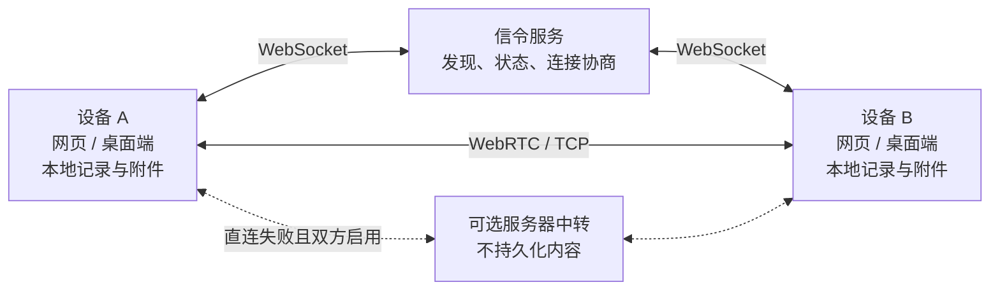

# 蜂鸟 · Hummingbird

[English](README.md) | 简体中文 · [GitHub](https://github.com/kuangye-team/ky-im)

轻快连接，自在分享。

蜂鸟是一款面向局域网的聊天与文件分享应用，支持网页、PWA 和 macOS / Windows 桌面客户端（Ky IM）。无需注册账号，文字、图片、文件和文件夹优先在设备之间直接传输，聊天记录保存在各自设备上。

服务端默认只负责设备发现与连接协商，不保存聊天内容。桌面端支持通过本地网络发现设备，无需中心服务器也能在局域网内通信。

[能力特性](#能力特性) · [架构原理](#架构原理) · [快速开始](#快速开始) · [配置说明](#配置说明) · [安装部署](#安装部署) · [参与贡献](#参与贡献) · [版权与许可证](#版权与许可证)

## 能力特性

| 能力 | 网页 / PWA | 桌面客户端 |
| --- | --- | --- |
| 设备发现 | 通过信令服务发现同组设备，支持跨组查找 | 同时支持信令服务与 mDNS 本地发现，合并重复设备 |
| 内容传输 | WebRTC 点对点传输文字、图片、文件和文件夹 | 优先 TCP，失败后尝试 WebRTC；可与网页互传 |
| 可选中转 | 直连失败时可经服务器转发，需服务器支持且双方启用 | 与网页相同，默认关闭 |
| 本地存储 | IndexedDB，受浏览器存储配额影响 | SQLite 保存记录，本地文件系统保存附件 |
| 大文件与文件夹 | 支持分块传输；直接保存到磁盘依赖浏览器文件系统能力 | 原生文件读写与流式落盘，保留目录结构 |
| 使用环境 | 桌面与移动浏览器、PWA 安装、离线访问本地记录 | macOS / Windows，支持无互联网的局域网通信 |
| 语言 | 中文、英文 | 中文、英文 |

## 架构原理



发现、传输和存储通过适配器分离，共用的 `ChatEngine` 处理消息、文件传输与持久化。设备使用本地持久化 UUID 标识，多个发现来源按该标识合并；文件按块传输，支持流式读写。

Rust 服务端共享同一套核心逻辑：原生服务采用 Axum / Tokio，在线状态保存在内存中；Cloudflare 版本采用 Workers / Durable Objects 保存在线资料。可选中转仅转发当前传输内容，两种后端均不保存聊天历史或中转内容。

| 模块 | 技术与职责 | 代码入口 |
| --- | --- | --- |
| 网页与共享业务 | React、TypeScript、Vite；界面、消息引擎、网络与存储适配器 | [`ssg/src/`](ssg/src) |
| 桌面客户端 | Tauri 2、Rust；mDNS / TCP、SQLite、本地文件系统 | [`app/src/`](app/src) |
| 信令与中转服务 | Rust；原生与 Cloudflare 两种运行方式 | [`api/src/`](api/src) |
| 共享协议 | 服务端与桌面端共用的网络类型 | [`shared/`](shared) |
| 构建与发布 | 配置生成、许可声明、桌面与服务端打包 | [`scripts/`](scripts) |

### 使用边界

- **发现与连通性**：网页自动分组依据 `VITE_ROOM` 和服务端看到的来源 IP，不扫描局域网。桌面本地发现需要可互通的 IPv4 网络、UDP 5353 组播及动态 TCP 端口。WebRTC 默认未配置 STUN/TURN，跨网直连取决于网络可达性。
- **在线与存储**：内容传输需要双方在线；服务端不代收离线消息，历史记录不会自动跨设备同步。PWA 离线缓存仅提供应用资源与本地记录访问，清除站点数据会删除网页端的本地身份和记录。
- **身份与隐私**：分组号码、UUID 和服务器访问密钥不能验证联系人身份，当前设备标识可被冒用，应在可信设备之间使用。WebRTC 提供传输加密，桌面 TCP 当前未加密；服务器中转不是端到端加密，中转服务器可接触内容。公开设备资料会发送给启用的发现服务。
- **浏览器能力**：大文件和原始文件夹接收取决于文件系统 API、存储配额与可用空间；生产网页使用 HTTPS，以支持 PWA 和受保护的浏览器能力。

## 快速开始

仅运行应用或托管服务可直接选择[安装部署](#安装部署)中的发布包或镜像；从源码开发需要以下工具。

| 工具 | 要求 | 用途 |
| --- | --- | --- |
| Node.js / npm | Node.js ≥ 22.12 | 配置生成、前端开发与构建 |
| Rust / Cargo | Rust ≥ 1.91 | 原生服务与桌面客户端 |
| 桌面平台依赖 | [Tauri 2 平台依赖](https://v2.tauri.app/start/prerequisites/) | 仅桌面开发与打包需要 |
| Docker / Compose | 可用的容器运行环境 | 仅容器部署需要，宿主机无需 Rust |

以下命令从新克隆的仓库开始；已有 `.env.json` 时保留原文件。

```sh
git clone https://github.com/kuangye-team/ky-im.git
cd ky-im
npm ci
npm --prefix api ci
npm --prefix ssg ci
cp .env.json.example .env.json
npm run init
npm run prepare
npm run dev
```

访问 <http://localhost:5173>。前端开发服务将 `/api` 请求代理到本地 `8080` 端口，`npm run dev` 同时启动前端与 API。

| 场景 | 根目录命令 | 结果 |
| --- | --- | --- |
| 网页开发 | `npm run dev` | 网页与原生 API 联合运行 |
| 桌面开发 | `npm run desktop:dev` | 启动 Ky IM；仅本地发现无需 API，在线发现需另行启动或连接信令服务 |
| 构建与本地预览 | `npm run build`，然后 `npm run preview` | 构建 API 与网页，在 `http://localhost:4173` 预览 |

## 配置说明

源码开发与构建统一编辑根目录 `.env.json`（按[示例](.env.json.example)创建），再运行 `npm run init`。生成的环境文件和 `wrangler.jsonc` 会被覆盖，持久修改应放在 `.env.json` 或对应的 `.example` 模板中。

| 配置分区 | 用途 | 生成位置 |
| --- | --- | --- |
| `local.api` / `local.ssg` | 本地开发 | `api/.env.local`、`ssg/.env.local` |
| `production.api` / `production.ssg` | 原生部署、网页正式构建 | `api/.env.production`、`ssg/.env.production` |
| `compose.root` / `compose.api` / `compose.ssg` | Docker 端口、运行时与前端构建参数 | 根目录 `.env`、`api/.env.compose`、`ssg/.env.compose` |
| `desktop.app` / `desktop.ssg` | 桌面签名、发布与前端参数 | `app/.env`、`ssg/.env.desktop` |
| `wrangler.api` / `wrangler.ssg` | Cloudflare 运行时变量 | `api/wrangler.jsonc`、`ssg/wrangler.jsonc` |

预构建镜像的 `docker/.env` 与服务端发布包的 `release/.env` 独立维护，不由初始化脚本生成。Cloudflare 的前端构建参数仍放在 `production.ssg`，`wrangler.*` 只设置运行时变量。

### 主要参数

| 参数 | 作用与配置要点 |
| --- | --- |
| `VITE_SIGNAL_URL` | 信令 WebSocket 地址；网页留空使用同源 `/api/ws`，分离部署使用完整 `wss://…/api/ws`；桌面安装包留空默认连接 `ws://127.0.0.1:8080/api/ws` |
| `VITE_ROOM` | 发现命名空间，默认 `local`，不用于访问控制 |
| `API_AUTH` / `VITE_API_AUTH` | 服务端访问密钥 / 默认服务器的前端预设密钥；使用相同的完整值，`API_AUTH` 留空关闭鉴权 |
| `RELAY_ENABLED` | 服务端中转开关，默认 `false`；开启后仍需双方在同一服务器上启用中转 |
| `BIND_ADDR` / `STATIC_DIR` | 原生服务监听地址与静态资源目录；相对路径以服务启动目录为准 |
| `CORS_ORIGINS` | 允许的前端来源，逗号分隔；分离部署时追加实际网页来源，保留所需的 Tauri 来源 |
| `TRUST_PROXY_HEADERS` | 是否信任代理转发的来源 IP；直接暴露服务时设为 `false`，仅在受控反向代理后开启 |
| `MAX_CONNECTIONS` / `MAX_ROOMS` / `MAX_PEERS_PER_ROOM` | 实例连接数、发现组数与每组设备数上限 |
| `WEB_PORT` / `API_HOST` | 本地网页端口与开发代理目标，示例为 `5173`、`http://127.0.0.1:8080` |
| `SERVER_PORT` / `NPM_REGISTRY` | Docker 宿主机端口与构建用 npm 源 |
| `TAURI_UPDATER_URL` / `TAURI_UPDATER_PUBLIC_KEY` / `TAURI_SIGNING_PRIVATE_KEY` | 桌面正式构建必需的 HTTPS 更新清单地址、公钥与签名私钥 |

`VITE_*` 会写入前端资源，修改后需要重新构建；`VITE_API_AUTH` 因此不应被视为仅服务器可见的秘密。示例访问密钥仅供演示，部署时按需替换或清空。启用 `API_AUTH` 后，WebSocket 与健康详情需要鉴权，基础 `/api/health` 和静态网页仍公开。

完整参数与默认值见 [API 模板](api/.env.example)、[前端模板](ssg/.env.example)、[桌面模板](app/.env.example)和[统一配置示例](.env.json.example)。私钥等敏感配置不应提交到仓库；桌面构建支持通过进程环境变量注入配置。

## 安装部署

| 方式 | 适用场景 | 产物 / 入口 |
| --- | --- | --- |
| macOS 桌面安装包 | Apple 芯片与 Intel Mac 独立应用 | [GitHub Releases](https://github.com/kuangye-team/ky-im/releases)：`ky-im-<版本>-macos-universal.dmg` |
| Windows 桌面安装包 | Windows x64 独立应用 | [GitHub Releases](https://github.com/kuangye-team/ky-im/releases)：`ky-im-<版本>-windows-x64-setup.exe` |
| 服务端发布包 | 无开发工具的主机运行网站与 API | `ky-im-<版本>-bin.tar.gz`，支持 Windows x64、Linux / macOS x64 与 ARM64 |
| Docker | 容器化部署网站与 API | [预构建镜像配置](docker/compose.yml)或[源码构建配置](compose.yml) |
| 原生源码构建 | 自行托管 Rust 服务与静态网页 | `api/target/release/server`、`ssg/dist/` |
| Cloudflare Workers | 托管前端与信令服务 | Workers Static Assets + Workers / Durable Objects |

### Docker

使用预构建镜像，无需安装 Node.js 或 Rust。从仓库根目录执行，已有 `docker/.env` 时保留：

```sh
cd docker
cp .env.example .env
docker compose pull
docker compose up -d
```

默认访问 <http://localhost:8080>，镜像版本和端口由 `docker/.env`（[示例](docker/.env.example)）配置。预构建前端使用同源信令地址；更改前端构建参数需要自行构建镜像。

从源码构建时，先完成依赖安装、配置初始化与许可声明生成，再在仓库根目录执行：

```sh
npm run init
docker compose up -d --build
```

根目录 Compose 已启用端口映射，默认同样为 `8080`。本地使用 OrbStack 时，在 Docker 命令中指定 `--context orbstack`。

### 原生服务

完成源码初始化并设置 `production` 配置后，在 macOS / Linux 终端执行：

```sh
npm run build
cd api
set -a
. ./.env.production
set +a
./target/release/server
```

默认从 `../ssg/dist` 提供网页。生产环境通过反向代理提供 HTTPS/WSS，转发 `/api`，包括 WebSocket `/api/ws` 与鉴权入口 `/api/ws/ticket`；`/api/health` 可用于健康检查。前后端分离时，同时配置 `VITE_SIGNAL_URL` 和 `CORS_ORIGINS`。

启用 `TRUST_PROXY_HEADERS` 时，代理应限制源站访问，并清理、覆盖所有受信任的转发头（包括 `Forwarded`），确保分组使用真实来源 IP。

### Cloudflare Workers

完成源码初始化后，安装与仓库依赖匹配的构建工具并登录：

```sh
rustup target add wasm32-unknown-unknown
cargo install worker-build --version 0.8.7 --locked
(cd api && npx wrangler login)
```

在 [API 模板](api/wrangler.jsonc.example)与[前端模板](ssg/wrangler.jsonc.example)中设置 Worker 名称和域名，并在 `.env.json` 中配置 `wrangler.api.CORS_ORIGINS` 与 `production.ssg.VITE_SIGNAL_URL`，然后执行：

```sh
npm run deploy
```

可用 `npm run deploy:api` 或 `npm run deploy:ssg` 单独部署。服务器密钥可使用 Wrangler Secret 管理；使用 `API_AUTH` Secret 时，从 `wrangler.api` 中移除同名变量。

### 桌面打包

准备平台依赖，在 `desktop.app` 或进程环境变量中配置更新地址与签名密钥，再执行 `npm run desktop:build`。macOS 通用包需预先安装两个 Rust 目标：

```sh
rustup target add aarch64-apple-darwin x86_64-apple-darwin
npm run desktop:build
```

Windows 上直接执行 `npm run desktop:build` 生成 x64 安装包。产物位于 `app/dist/`，包含安装包、签名更新产物、校验文件和更新清单。更新签名与操作系统代码签名分别配置，参数见[桌面模板](app/.env.example)，自动发布流程见[发布工作流](.github/workflows/release.yml)。

通过 GitHub Actions 发布桌面应用时，在仓库的 **Settings → Secrets and variables → Actions** 中配置以下仓库级参数。桌面构建优先读取同名 Secret，其次读取 Variable：

| 参数 | 建议位置 | 未配置时的默认值 |
| --- | --- | --- |
| `VITE_SIGNAL_URL` | Variables | 留空，安装包连接 `ws://127.0.0.1:8080/api/ws` |
| `VITE_API_AUTH` | Secrets | 留空，不预设访问密钥 |
| `VITE_ROOM` | Variables | `local` |
| `VITE_STORAGE_CHUNK_SIZE` | Variables | `2097152`（2 MiB） |

这些参数在桌面前端构建时写入，修改后需重新构建安装包。工作流不会读取本机的 `.env.json` 或生成的 `.env` 文件。即使使用 Actions Secret，`VITE_API_AUTH` 仍可从分发的应用中读取。

## 参与贡献

欢迎通过 [Issue](https://github.com/kuangye-team/ky-im/issues) 或 [Pull Request](https://github.com/kuangye-team/ky-im/pulls) 参与。提交前验证受影响的功能，并同步相关配置与文档。[持续集成](.github/workflows/ci.yml)覆盖前端类型检查、单元测试、真实浏览器通信测试及桌面 Rust 检查；[镜像发布](.github/workflows/docker-publish.yml)与[应用发布](.github/workflows/release.yml)负责构建和分发产物。

## 版权与许可证

Copyright (c) 2026 旷野团队。本项目采用 [MIT 许可证](LICENSE)，第三方依赖与素材遵循各自的许可证。

安装或更新前端依赖后，运行 `npm run prepare` 生成 `ssg/public/licenses/` 下的第三方许可声明，并随前端产物分发。桌面发布构建和 GitHub Actions 已包含此步骤；自行构建网页或 Docker 镜像时需先生成声明。
