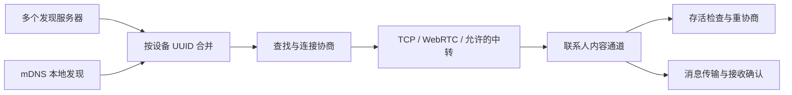

# 通信架构

发现、存活、通道和送达分别判断。在线状态仅作提示：对方离线也可尝试发送，界面提醒可能接收不到；通道打开即可发送，无需等待 pong。消息以对端保存后的 ack 为送达依据。

## 发现与传输

| 层次 | 规则 |
| --- | --- |
| 身份 | UUID 关联联系人和历史；蜂鸟号是分组入口，恢复联系人时必须校验 UUID |
| 多来源发现 | 各来源独立心跳、重连；按 UUID 合并，一个来源失效不移除其他来源仍能发现的设备 |
| 协商路由 | 优先沿对端信令来源回复，否则选择能发现目标的可用来源；来源断开后可换路由 |
| 直接传输 | 网页使用 WebRTC；桌面同时启用时先 TCP，约 4 秒未打开则回退 WebRTC |
| 中转 | 直连尝试约 10 秒后可回退；要求服务器支持且双方在该服务器允许中转 |
| 消息 | 一个联系人使用一个选定通道；接收方保存后回复 ack，无确认则按消息超时处理 |

发现服务器的心跳只验证发现服务，不能证明联系人存活。

## 存活与离线

**连续 3 个探测周期无法确认存活，标记离线。** 每个周期以实际发出的 ping 及其等待期为准，不按定时器执行次数累加。

| 事件 | 状态处理 |
| --- | --- |
| 发送消息得到对端 ack、收到对端消息或有效文件数据 | 清零连续失败次数，恢复在线 |
| 当前探测收到有效 pong，或收到对端合法 ping 等响应 | 同样清零并恢复在线 |
| 一次探测超时，期间没有有效通信 | 失败次数加一；无在途内容时重协商当前联系人 |
| 连续第三次无法确认存活 | 标记离线，继续重试，仍允许发送 |
| 重建通道、重复发现或更新资料 | 不清零计数，不凭通道重新打开恢复在线 |
| 明确传输失败或所有发现来源报告离开 | 标记离线；保留本地历史 |
| 应用从休眠恢复 | 清零旧计数并重新探测，不把休眠时间计作失败；已有离线提示等有效响应再恢复 |

计数按联系人保存，跨通道重建延续。错误 ID、过期 pong、旧通道的迟到事件不能确认新通道。发送成功指对端确认接收，本机 `send()` 返回只表示数据已交给本机通道。

旧客户端无需支持 ping/pong：正常消息和接收确认同样证明存活。离线标记不取消正在传输的内容；在途消息继续遵守自己的接收同意、进度和确认超时，完成后再处理待重协商。

## 调度

| 项目 | 默认值 |
| --- | --- |
| 当前聊天 / 列表检查 | 10 秒 / `VITE_PEER_CHECK_INTERVAL_MS`，默认 10 秒，范围 1–300 秒 |
| 单次探测等待 | 8 秒；文件传输繁忙时 60 秒 |
| 建连等待 / 暂时断开宽限 | 15 秒 / 8 秒 |
| 联系人重试 | 约 1、2、4、8、16、30 秒，带抖动；后台不短于列表检查间隔 |
| 后台建连并发 | 最多 4 个；显式发送可立即尝试 |
| 发现服务心跳 / 重连 | 20 秒检查，55 秒无回复失效；重连退避最多 120 秒 |
| 普通消息确认 | 30 秒；流式传输使用更长等待 |

重连退避、繁忙宽限和系统调度会延长判定时间，“3 个周期”不等于固定 30 秒。本机主动离线会停止网络、探测和重试。

## 当前边界

- 没有服务器离线代收或自动重发；未送达内容保留失败记录。
- 默认 WebRTC 没有 STUN/TURN，不能保证穿越所有网络限制。
- 重协商先关闭旧通道，再执行传输选择；尚无无缝切换、跨服务器质量评分或心跳能力协商。
- 最后一个发现来源移除联系人，或单发现会话整体断开时，当前实现仍会清理相关内容通道。

实现入口：[引擎](../ssg/src/core/engine.ts)、[网络适配器](../ssg/src/core/network/)、[配置](../ssg/src/config.ts)。故障定位见 [排障指南](trouble.md)。
