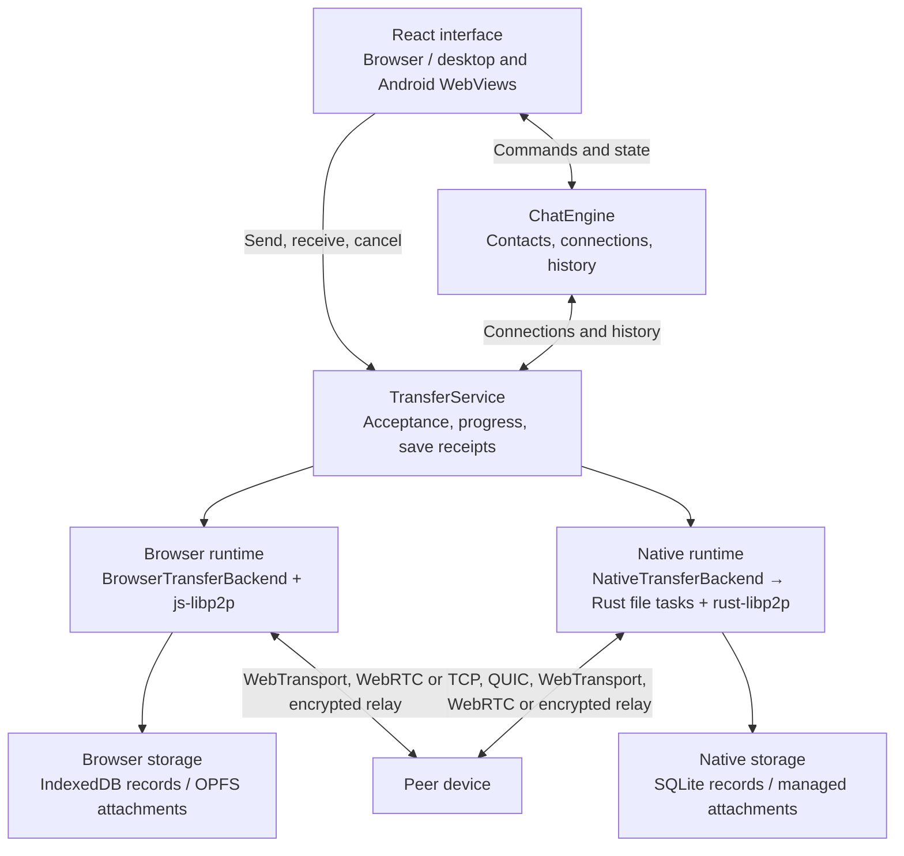
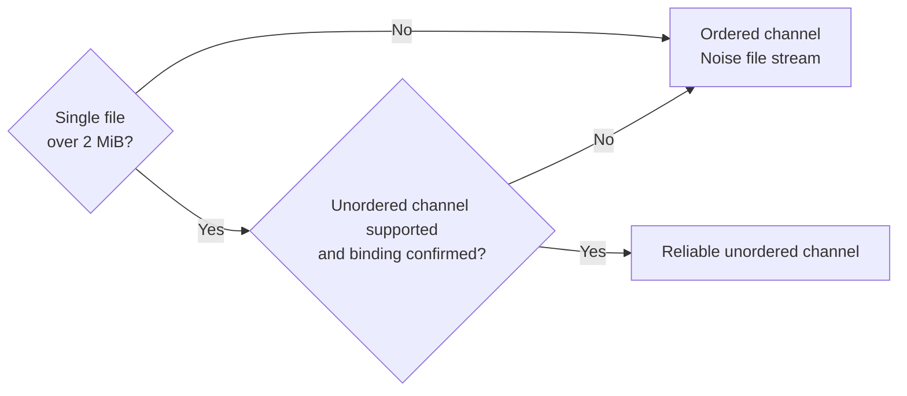

# Communication architecture

English | [简体中文](arch.zh.md) · [Project overview](../README.md)

## Layers and data flow

A device's identity is its PeerId, derived from a persistent Ed25519 key. Its six-digit Hummingbird number is used for discovery. Several devices can share a number and still have distinct identities. The two peers handle messages, attachments, and save receipts. Each keeps its own offline history.

## Discovery and connections

| Stage | How it works |
| --- | --- |
| Discovery | Each device registers over a WebSocket with each enabled signaling server by signing a challenge. Servers group devices by namespace and source IP and support number lookups. Desktop clients also advertise LAN addresses over mDNS. All clients merge discoveries and saved chats by PeerId. A successful number lookup saves a chat for each device. Reconnecting subscribes to the ten most recent distinct contact numbers. Older chats reconnect individually by device identity. |
| Connection setup | libp2p authenticates the peer and opens business streams. TCP, WebRTC and WebSocket tunnels use Noise and Yamux. QUIC provides authentication and multiplexing. ICE selects a direct or TURN-relayed path. When WebRTC is needed, the browser exchanges SDP on `/hummingbird/rtc-signal/2.0.0` over an authenticated WebTransport connection. If there is no carrier or stream negotiation fails, it sends `session` and `description` in `signal.data` through the server. A failed stream attempt gets a fresh session ID on fallback. |
| Browser to desktop | A desktop includes a reverse-dial request in its pinned address announcement. Discovery and listener updates share a 100 ms debounce per peer, with address sets deduplicated per server session. In a secure context the browser tries up to four peers in the background and backs off on failure. The desktop reuses the connection or asks the browser to dial again when sending. Noise authenticates the first bidirectional stream. Later streams carry chat and files. Each listener rotates its 14-day certificate every seven days. [libp2p WebTransport specification](https://github.com/libp2p/specs/blob/master/webtransport/README.md) |
| Server relay | If both peers opt in and are visible on the same relay-enabled server, it can forward ciphertext. The server sees discovery summaries, peer identities, timing, and traffic volume. |
| Presence | Authenticated traffic, receipts, and successful probes confirm presence. Peers exchange profile revisions and fetch changed profiles on demand. A failed probe triggers connection recovery. Rediscovery brings the next check forward. |
| Server heartbeat | Each server connection tracks its own incoming traffic. Responses, signaling and relay traffic postpone its next ping. The native server probes idle connections and closes unresponsive ones. |

Messages, transfers, and probes reuse a healthy connection to the same PeerId. Each client retains up to ten idle peers, prioritizing recent exchanges. Active transfers and pending receipts keep their connections. Losing a signaling server closes its tunnels and pending negotiations. An established desktop WebRTC connection can continue independently.

The native Axum/Tokio server keeps its online directory in memory. The Cloudflare Worker splits room connections, number memberships and subscriptions, and device session routes across three Durable Object classes. Both share protocol parsing, signature verification, and relay flow control.

## File transfers and data ownership

| Component | Responsibility |
| --- | --- |
| `ChatEngine` | Provides connections and conversation history, publishes state to the UI, and tells the transfer service when a connection drops, history is deleted, or the engine stops. |
| `TransferService` | Handles `engine.transfers` commands. Coordinates acceptance, folder entry order, cancellation, resume negotiation, and final receipts. |
| `BrowserTransferBackend` | Reads and chunks files in the browser and writes to protocol streams within the send window. Streams incoming attachments into OPFS and stores records in IndexedDB. |
| `NativeTransferBackend` | Submits file sources and task commands through `FileTaskExecutor` and reports aggregate progress to the WebView. |
| Rust file tasks and storage | File tasks hold source handles and control read-ahead, chunking, receive order, and resume offsets. Storage manages paths, commits writes, cleans up cancellations, and reads saved attachments. [File tasks](../app/src/p2p/files.rs) · [Storage](../app/src/storage) |
| Rust networking | Rust handles server WebSockets and relay flow control. The system WebView shares SDP, ICE and DataChannel handling with the browser. Rust can exchange SDP over an authenticated desktop connection. [WebRTC implementation](../ssg/src/core/network/libp2p/bridge.ts) The transport module connects bounded byte pipes to the same Swarm. [Network](../app/src/p2p/network.rs) · [Transport](../app/src/p2p/transport.rs) |

Desktop users grant access to disk files through the native picker or drag and drop. Saved chat attachments are opened by their managed identifiers. WebRTC transfers pass file blocks between Rust and the WebView over bounded binary IPC. TCP, QUIC and WebTransport transfers use native sockets directly. Content originating in the WebView, such as clipboard data, is staged in chunks before it goes to a native task. Concurrent large-file sends share the native scheduling policy until the last active send pauses or ends.

The receiver verifies the size, commits the attachment, and saves the message before sending the final receipt. Peers can resume interrupted transfers within the same running session. For folders, the receiver confirms the entry index, file offset, and next chunk number.

Choosing an external destination during a single-file transfer moves the received prefix before writes continue there. The chat keeps the transfer record. If the attachment was already committed, the client exports a copy.

### WebRTC file channels

Chat messages, folders, and save receipts always use the ordered channel. Once the receiver accepts a single file, the sender selects a path for its contents on the same WebRTC connection.

Peers advertise the unordered channel in SDP and bind it to the authenticated PeerId by checking the RTC session ID and both DTLS certificate fingerprints on the Noise chat stream. If binding fails or times out, the sender uses the ordered stream.

For an unordered transfer, the sender splits each block into fragments and sends its descriptor on the ordered file stream. The receiver deduplicates fragments and reassembles blocks in bounded memory before writing them in order. Senders pause when the DataChannel queue fills. On desktop the WebView reads the DTLS fingerprints, sends fragments and reassembles incoming blocks. Rust exchanges binding messages, descriptors and save receipts on the authenticated connection. [File and WebRTC tuning](option.md#file-and-webrtc-tuning)

## Local storage

| Data | Browser / PWA | Desktop |
| --- | --- | --- |
| Identity and message history | `ky-im` IndexedDB database | SQLite at `data/ky-data/history.sqlite` under the app data directory |
| Attachments | OPFS under `ky-im-files/ky-im/`, subject to the site's quota | `ky-files/` for saved attachments and `ky-cache/` for writes in progress under the selected file location |
| Settings | Device preferences use the `hummingbird.` prefix | `storage-location.sqlite` in `ky-data/` records the file location. `storage.lock` coordinates exclusive access. |

A full reset stops writes before clearing local application data. The desktop acquires storage locks, and the browser waits for the site's database connections to close. Files exported to a user directory are managed by the user.

[Capability negotiation](capabilities.md) · [Configuration reference](option.md)
