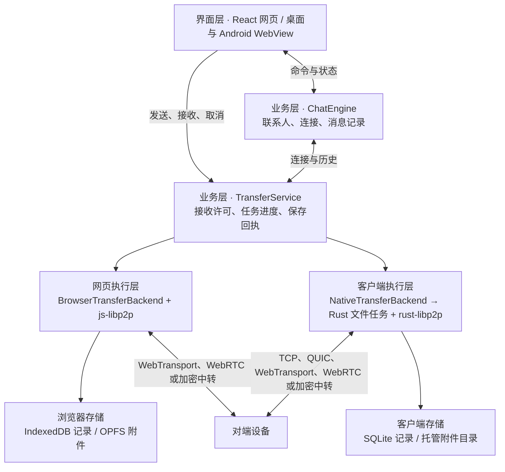
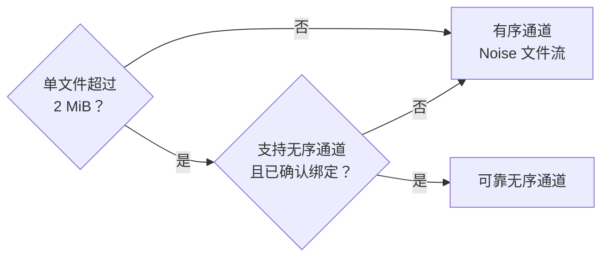

# IM 通信设计

[English](arch.md) | 简体中文 · [项目首页](../README.zh.md)

## 分层与数据流

设备以持久化 Ed25519 密钥派生的 PeerId 标识身份。六位蜂鸟号用于发现设备，同号设备可拥有不同身份。消息、附件及保存回执均由通信双方处理，离线记录保存在各自设备上。

## 发现与连接

| 环节 | 工作方式 |
| --- | --- |
| 设备发现 | 设备通过 WebSocket 与各个启用的信令服务连接，签名验证后注册。服务端按命名空间和来源 IP 分组，支持按号码查找。桌面还通过 mDNS 发布局域网地址。三端按 PeerId 合并已发现设备和已保存会话。蜂鸟号查找成功即保存各设备的会话。重新连接时自动订阅最近十个不同的联系人号码，较早的会话可按设备身份单独重连。 |
| 建立连接 | libp2p 验证 PeerId 并打开业务流。TCP、WebRTC 和 WebSocket 隧道使用 Noise 与 Yamux，QUIC 自带认证和流复用。ICE 可选直连或 TURN 中继路径。需要 WebRTC 时，网页通过已认证的 WebTransport 连接在 `/hummingbird/rtc-signal/2.0.0` 流上交换 SDP。没有可用直连或流内协商失败时，经中心 WS 转发 `signal.data` 中的 `session` 和 `description`。流内协商失败后使用新的会话 ID。 |
| 网页直连桌面 | 桌面发现支持反拨的网页时，将反拨意图附在带证书指纹的地址公告里。发现与监听变化按设备合并 100 毫秒，相同地址集合在同一中心会话中去重。网页在安全上下文中最多同时后台尝试四台设备，失败后退避重试。桌面发送时复用连接，或请求网页重新拨号。首条双向流通过 Noise 认证，后续流可直接收发聊天和文件。桌面监听证书有效期 14 天，每 7 天轮换并更新公告。[libp2p WebTransport 规范](https://github.com/libp2p/specs/blob/master/webtransport/README.md) |
| 中心中转 | 双方在同一中心可见并同意中转，且中心已启用中转时，中心可转发密文。中心可见发现摘要、设备身份、通信时间与流量。 |
| 在线状态 | 已认证连接上的业务数据、回执或成功探测可确认在线。双方交换资料修订号，按需获取更新。探测失败时尝试恢复连接，重新发现设备时提前复查。 |
| 中心心跳 | 每条中心连接单独计时。收到有效响应、信令或中转数据会延后该连接的 ping。原生服务端同样在入站通信静默后才探测，长时间无回应会断开。 |

消息、文件传输和探测复用同一 PeerId 的健康连接。每个客户端最多保留十台空闲设备的连接，优先保留最近收发过内容的设备。传输中或等待回执的连接持续保留。桌面与信令服务断开时，会关闭该服务的隧道并清理尚未完成的协商，已建立的 WebRTC 连接可以继续使用。

原生服务使用 Axum / Tokio，在内存中维护在线目录。Cloudflare Worker 用三种 Durable Object 分别管理房间连接、号码成员与订阅、设备会话路由。两种部署共用协议解析、签名验证和中转流控。

## 文件传输职责与数据边界

| 模块 | 职责与数据 |
| --- | --- |
| `ChatEngine` | 提供连接与会话记录，向界面发布状态。断线、删除历史和停止时通知传输服务。 |
| `TransferService` | 接受 `engine.transfers` 命令，管理接收许可、文件夹条目顺序、取消、续传协商与最终回执。 |
| `BrowserTransferBackend` | 在浏览器读取文件、分块并按发送窗口写入协议流。接收附件流式写入 OPFS，记录保存在 IndexedDB。 |
| `NativeTransferBackend` | 通过 `FileTaskExecutor` 提交文件来源及任务命令，将原生任务的汇总进度交给 WebView。 |
| Rust 文件任务与存储 | [文件任务](../app/src/p2p/files.rs)持有源句柄，控制预读、分块、接收顺序与续传偏移。[存储服务](../app/src/storage)负责托管路径、写入提交、取消清理与历史附件读取。 |
| Rust 网络 | [网络模块](../app/src/p2p/network.rs)处理中心 WebSocket 与中转流控。系统 WebView 与网页共用 [WebRTC 实现](../ssg/src/core/network/libp2p/bridge.ts)，处理 SDP、ICE 和 DataChannel。Rust 可通过已认证的桌面连接交换 SDP。[传输模块](../app/src/p2p/transport.rs)用有界字节管道接入同一个 Swarm。 |

桌面普通磁盘文件由原生选择器或拖放授权，历史附件通过托管标识读取。WebRTC 文件块通过有界二进制 IPC 交给 WebView，TCP、QUIC 与 WebTransport 文件块直接走 Rust 网络。剪贴板等 WebView 生成的内容先分块暂存，再交给原生任务。并发发送大文件时，各任务共享系统调度策略，最后一个活跃任务暂停或结束时释放。

接收端校验大小、提交附件并保存消息后才发送最终回执。双方可以在同一次运行会话内断线续传。续传文件夹时，由接收方确认条目编号、文件偏移和下一块序号。

接收单文件时若选定外部保存位置，客户端会先迁移已接收的部分，再继续写入，聊天中保留传输记录。如果选择时附件已经提交，则导出一份副本。

### WebRTC 大小文件分流

聊天消息、文件夹和保存回执始终走有序通道。接收方同意接收单文件后，发送方在同一条 WebRTC 连接上选择正文通道。

双方通过 SDP 声明支持无序通道，再在已验证 PeerId 的 Noise 聊天流上核对 RTC 会话 ID 和双方的 DTLS 证书指纹，将通道绑定到对端身份。核对失败或超时就走有序通道。

发送端把文件块拆成分片，通过无序通道发送，并在有序文件流中发送块描述符。接收端在有界缓冲中去重、重组，再按块顺序写盘。DataChannel 发送队列满时暂停提交。桌面由 WebView 获取 DTLS 指纹、发送分片并在接收时重组正文。Rust 在当前认证连接上交换绑定消息、描述符和保存回执。[文件与 WebRTC 参数](option.zh.md#文件与-webrtc-参数)

## 本地存储

| 数据 | 网页 / PWA | 桌面 |
| --- | --- | --- |
| 身份与消息记录 | IndexedDB `ky-im` | SQLite，固定在应用数据目录的 `data/ky-data/history.sqlite` |
| 附件 | OPFS `ky-im-files/ky-im/`，受站点配额约束 | 当前文件位置的 `ky-files/` 保存附件，`ky-cache/` 保存进行中的写入 |
| 配置 | 本机偏好使用 `hummingbird.` 前缀 | `ky-data/` 内的 `storage-location.sqlite` 记录文件位置，`storage.lock` 协调独占访问 |

全量重置会先停止写入，再清理本机的应用数据。桌面端先取得存储锁，网页端等待本站数据库连接关闭。导出到用户目录的文件由用户管理。

[能力协商](capabilities.zh.md) · [配置参考](option.zh.md)
